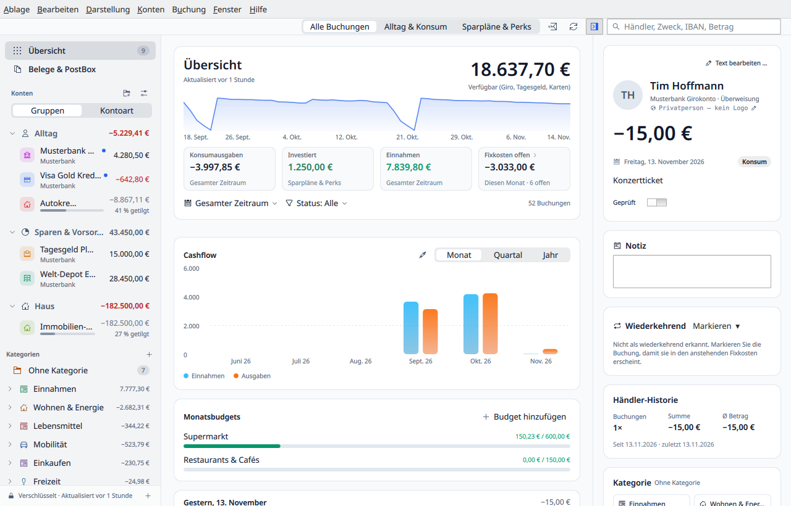
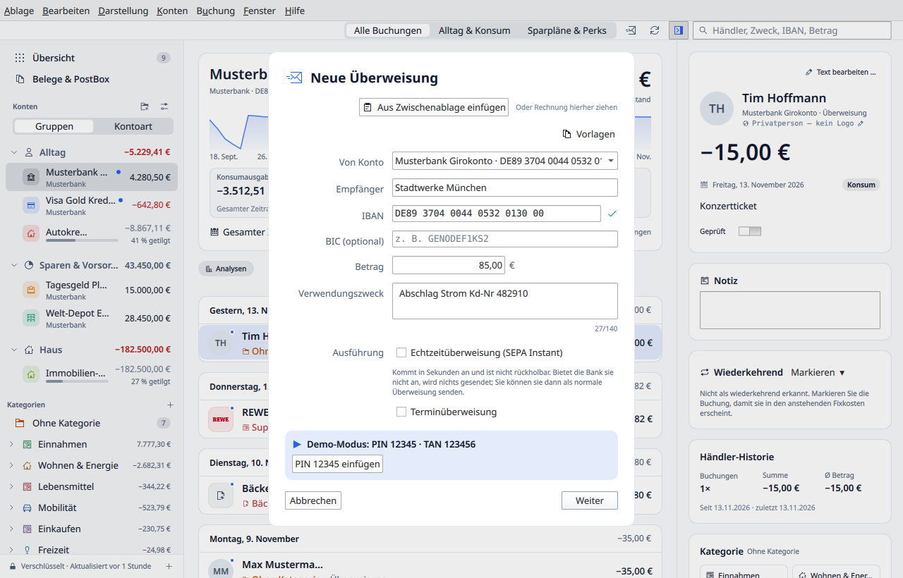
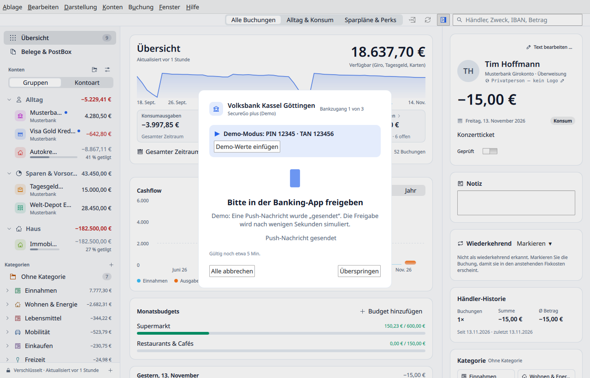
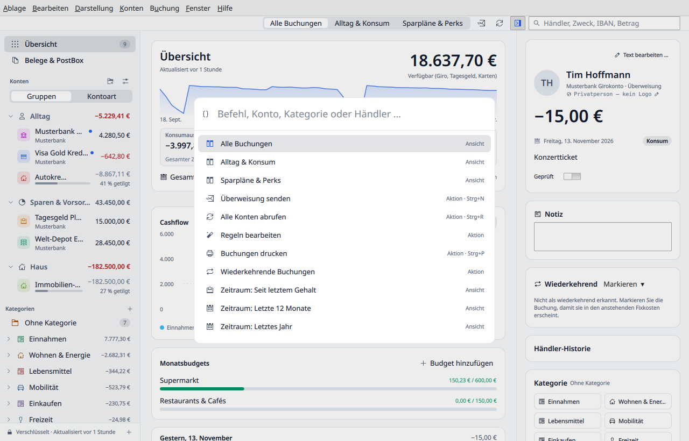
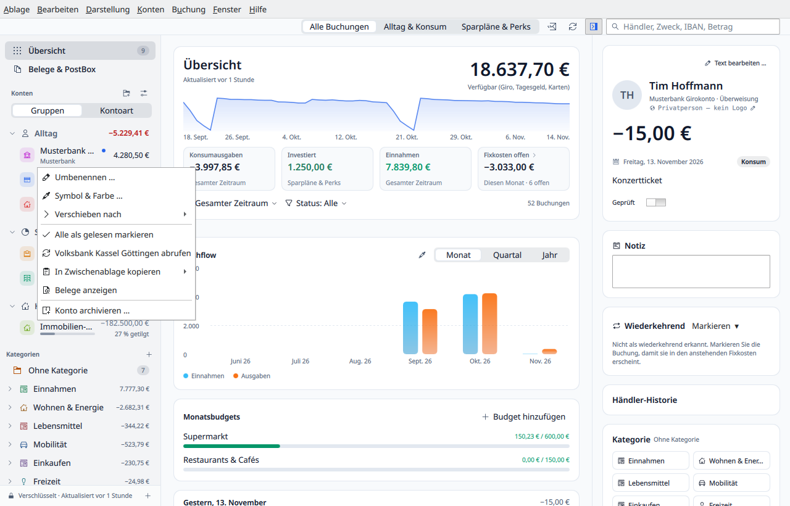
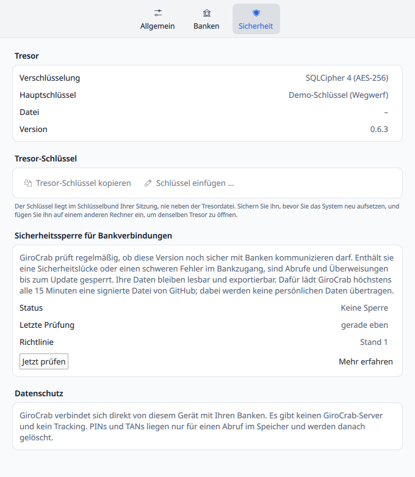

# GiroCrab für Linux (Qt 6 / QML)

Linux-Oberfläche für GiroCrab auf demselben Rust-Kern (`girocrab-core`) wie die Mac- und iOS-App.
Die QML-Ansichten bilden die SwiftUI-Ansichten aus `GiroCrabApp/Sources/GiroCrabUI` Datei für Datei nach:
gleiche Struktur, gleiche Texte, gleiche Design-Tokens (`Theme`), gleiche Logik im `AppModel`.

## Screenshots (Demo-Daten)

| Hauptfenster | Überweisung |
|---|---|
|  |  |
| **Abruf mit S-pushTAN** | **Befehlspalette (Strg+K)** |
|  |  |
| **Kontomenü** | **Einstellungen › Sicherheit** |
|  |  |

## Architektur

```
QML (qml/*.qml)  ──Core.call / Core.callAsync (JSON)──▶  src/bridge.rs (cxx-qt QObject „Core“)
                                                          └─ src/dispatch.rs ─▶ girocrab_core::Vault
```

- **Kein UniFFI auf Linux.** Die Oberfläche ruft die Rust-API direkt auf. Die FFI-Records und -Enums des Kerns
  werden über das optionale Feature `serde` von `girocrab-core` nach JSON (de)serialisiert. Die Mac-App
  baut ohne dieses Feature und bleibt unverändert.
- `src/dispatch.rs`: eine Zeile pro Kernmethode (`vault_methods!`). Argumentnamen = Rust-Parameternamen (snake_case).
- `Core.callAsync` läuft in einem Worker-Thread und antwortet über das Signal `finished(ticket, json)`.
  Das ist das Gegenstück zu `AppModel.offMain` in Swift.
- `AppModel.qml` (Singleton) entspricht `AppModel.swift`. `Theme.qml` und `Fmt.qml` entsprechen `Formatting.swift`.
  `SF.qml` ordnet SF-Symbol-Namen (die im Tresor gespeichert sind) Breeze-Icons zu.
- Eigener Cargo-Workspace: `cargo clippy --workspace` der Mac-CI braucht kein Qt.

## Bauen und starten

Voraussetzungen (Debian/Ubuntu/Kubuntu): Rust (rustup) sowie
`qt6-base-dev qt6-declarative-dev qml6-module-qtquick-dialogs qml6-module-qtquick-controls qml6-module-qtquick-layouts qml6-module-qtquick-shapes qml6-module-qt-labs-qmlmodels`
und Kirigami (`qml6-module-org-kde-kirigami`, für die Breeze-Icons). Für die Zustimmungsseiten der Banken und die PDF-Vorschau
zusätzlich `qml6-module-qtwebengine` und `qml6-module-qtquick-pdf` (werden erst bei Bedarf geladen).
Optional `tesseract-ocr tesseract-ocr-deu`: Texterkennung für fotografierte Kassenbons und Rechnungen (wie Vision auf dem
Mac). Ohne das Programm oder die deutschen Sprachdaten werden Fotos nur nach Betrag, Datum und Dateiname zugeordnet.
Zum Drucken braucht die App `qml6-module-qtwebengine` und `qt6-image-formats-plugin-pdf`: Wie auf dem Mac setzt eine
Browser-Engine den Bericht, mit demselben HTML, Stylesheet und Seitenumbruch-Skript. CSS und Skript liest `build.rs` beim
Bauen direkt aus `GiroCrabApp/Sources/GiroCrabUI/PrintReport.swift`, damit beide Ausdrucke gleich bleiben. Vor dem Druck
zeigt eine Vorschau alle Seiten; „In Datei drucken“ speichert das PDF unverändert.
Auch die Web-Logins (Trade Republic, Amex, Amazon, FNZ, quirion) brauchen nur `qml6-module-qtwebengine` zur Laufzeit:
`cpp/webcookies.cpp` liest den Cookie-Speicher von QtWebEngine ohne gegen QtWebEngine zu linken (QtNetwork aus
`qt6-base-dev` genügt zum Bauen); fehlt das Modul, startet die App trotzdem und meldet es erst beim Web-Login.

Fedora (der erste Befehl genügt zum Bauen und Starten, geprüft mit Fedora 43 in einem frischen Container;
`qt6-qtpdf` enthält auch das PDF-Plugin für den Druck):

```sh
sudo dnf install rust cargo gcc-c++ perl dbus-devel pkgconf-pkg-config \
  qt6-qtbase-devel qt6-qtdeclarative-devel kf6-kirigami breeze-icon-theme
# optional: Web-Logins, PDF-Vorschau und Drucken / Texterkennung / schnelleres Linken
sudo dnf install qt6-qtwebengine qt6-qtpdf tesseract tesseract-langpack-deu mold
```

`perl` ist das vollständige Paket, nicht nur `perl-interpreter`: SQLCipher bringt ein eigenes OpenSSL mit, dessen
`Configure` Perl-Module wie `lib`, `Time::Piece` und `IPC::Cmd` braucht (sonst bricht der Build bei `openssl-sys` ab).
`libdbus-sys` (Schlüsselbund, Secret Service) braucht `dbus-devel`. Ohne `kf6-kirigami` lässt sich die App bauen,
startet aber nicht (`module "org.kde.kirigami" is not installed`).

```sh
cd GiroCrabLinux
cargo run                                  # startet mit dem Demo-Tresor
cargo run -- --screenshot /tmp/shot.png    # rendert einmal, speichert ein Bild, beendet sich
cargo run -- --demo-settings banks:edit --screenshot /tmp/s.png   # Einstellungen-Fenster
cargo run -- --demo-sheet recurring --screenshot /tmp/r.png       # ein Sheet mit erfundenen Daten
```

## Flatpak

Für Fedora, openSUSE, Arch und andere Distributionen ohne `.deb`: `packaging/flatpak/de.girocrab.GiroCrab.yml`
(KDE-Runtime 6.11 mit Qt 6 und Kirigami, QtWebEngine/QtPdf aus `io.qt.qtwebengine.BaseApp`, Tesseract 5.5 mit
deutschen und englischen Sprachdaten). Die CI (`.github/workflows/ci.yml`, Job `flatpak`) legt für x86_64 (in PRs) und aarch64 (auf `main`) je ein
`girocrab.flatpak` als Workflow-Artefakt ab. Selbst bauen (aus dem Wurzelverzeichnis des Repositorys):

```sh
flatpak install --user flathub org.flatpak.Builder
flatpak run org.flatpak.Builder --user --install-deps-from=flathub --force-clean --repo=repo \
  build-dir GiroCrabLinux/packaging/flatpak/de.girocrab.GiroCrab.yml
flatpak build-bundle repo girocrab.flatpak de.girocrab.GiroCrab
flatpak install --user girocrab.flatpak && flatpak run de.girocrab.GiroCrab
```

Meldet der Builder „Failure spawning rofiles-fuse“, `--disable-rofiles-fuse` ergänzen. Der Bau läuft ohne Netz: alle Quellen sind per sha256 festgelegt, die Crates stehen in
`packaging/flatpak/cargo-sources.json`. Nach jeder Änderung an `Cargo.lock` `packaging/flatpak/update-cargo-sources.sh`
ausführen und das Ergebnis mit committen (die CI prüft das).

Berechtigungen:

| Berechtigung | Wofür |
|---|---|
| `--socket=wayland`, `--socket=fallback-x11`, `--share=ipc`, `--device=dri` | Fenster und GPU (Qt Quick) |
| `--share=network` | Abruf bei den Banken, Web-Logins |
| `--talk-name=org.freedesktop.secrets` | Tresor-Schlüssel im Secret Service (GNOME Keyring, KWallet, KeePassXC) |
| `--socket=cups` | Drucken |
| `--filesystem=xdg-config/kdeglobals:ro` | Plasma-Farben und -Schriften |
| `--filesystem=xdg-download:ro` | Per Drag & Drop abgelegte Kontoauszüge, Rechnungen und Belegfotos kommen als Pfad an, meist aus „Downloads“ |

Dateidialoge (Import, Export, Belege sichern, MoneyMoney-Datenbank oder -Ordner) laufen über das
Dateiauswahl-Portal und brauchen keine Dateisystem-Berechtigung. Ausnahmen: Dateien, die von anderswo als „Downloads“
ins Fenster gezogen werden, liest die App nur, wenn der Dateimanager sie über das Portal freigibt; sonst den Dialog
nehmen. Wird nur `MoneyMoney.sqlite` gewählt, sieht die App den Ordner `Statements` daneben nicht: den ganzen
MoneyMoney-Ordner oder den Kontoauszugsordner extra wählen. „Als PDF drucken“ kann nur in Ordner schreiben, auf die
die App Zugriff hat (z. B. per `flatpak override --user --filesystem=xdg-documents de.girocrab.GiroCrab`).

**Eigener Tresor:** Das Flatpak sieht `~/.local/share/GiroCrab` nicht. Sein Tresor liegt in
`~/.var/app/de.girocrab.GiroCrab/data/GiroCrab/tresor.girocrab`, die Einstellungen unter
`~/.var/app/de.girocrab.GiroCrab/config/`. Der Schlüssel im Secret Service ist derselbe Eintrag wie beim `.deb`; wer
von der nativen Installation wechselt, kopiert `tresor.girocrab` in den neuen Ordner.

## Port-Status

| Swift-Datei | QML / Rust | Stand |
|---|---|---|
| RootView | Main.qml | Fenster, Menüs, Toolbar, Dreispalten-Layout, alle Sheets, Fehler-Alert |
| AppModel, AccountGroupsModel | AppModel.qml | Auswahl, Zeitraum, Filter, Laden, Tagesgruppen, Marker, KPIs, Bearbeiten, Abruf, Überweisung, Import |
| Formatting | Theme.qml, Fmt.qml | Tokens, Money, DateText, IBAN |
| TextSize | Theme.qml, GeneralSettings.qml, Main.qml | Schriftgröße ×1 / ×1,15 / ×1,3 (Einstellungen › Allgemein, Darstellung › Größer Strg++ / Kleiner Strg+- / Originalgröße Strg+0; QSettings `textSize`). Skaliert die Textstile, die Standardschrift der Steuerelemente, Seitenleisten-, Sheet- und Einstellungsbreite sowie die Signets wie auf dem Mac; Menüs bleiben in Systemgröße |
| SidebarView, AllAccountsRoot, AccountGroupsUI, AccountSettingsView, AppModel+CategoryDuplicate | SidebarView.qml, SidebarModel.qml, SidebarRow.qml, SidebarChevron.qml, AccountRow.qml, NewCountBadge.qml, AccountsSectionHeader.qml, AccountSettingsView.qml, DropSlot.qml | „Neue Umsätze“ und „Vermögen“ oben, einklappbare Abschnitte Konten / Zahlungen (Geplant, Lastschriften mit Zählern) / Dokumente / Kategorien (Zustand gemerkt), eine Chevron- und Icon-Spalte, „Alle Konten“ mit Summe je Währung, Gruppen/Banken/Kontoart, Kontosuche, Konten mit Zähler am Signet (Inhaber als Tooltip, archivierte ohne Saldo), „Hinzufügen …“-Menü, Drag & Drop (auch Kategorien: davor, dahinter oder hinein, Kontextmenü „Nach oben“ / „Nach unten“, #977, `reorder_categories`), Kontextmenüs (Konto: „Einstellungen …“ öffnet die Kontoeinstellungen mit Name, Symbol & Farbe, Kontoinhaber, Kontoart, Startsaldo, Kontodaten, Notiz und „Das Konto wurde aufgelöst“, #981; Kategorie duplizieren, „Ohne Kategorie“ umbenennen), aufgeklappte Kategorien je Tresor gemerkt; Kategoriesummen folgen Status, Buchungsart und (in Kategorieansichten) dem Kontenfilter mit Hinweis „Summen gefiltert – …“ (#621, `list_categories_filtered` im Worker-Thread) |
| NewBookingsView, NewBookings | BookingStreamView.qml (NewBookingsCardHeader), AppModel.qml (newBookingSections) | „Neue Umsätze“: eine Karte je Konto mit den ungeprüften Buchungen |
| BookingListView | BookingStreamView.qml | Tageskarten, Zeilen, Chips (Kategorie-Chip je Konto abschaltbar im Kontomenü, QSettings `hiddenCategoryChipAccounts`, #336; Gegenkonto „⇄ Name“, #523), Beleg-Symbol mit Tooltip „Beleg(e) – Leertaste für Vorschau“ (#675), Mehrfachauswahl, Kontextmenü, Tastatur (Pfeile, C, R), „Weitere Buchungen laden“. Nur unter Linux: Beim Scrollen zeigt eine Blase am Griff den Tag der obersten Buchung, im noch nicht geladenen Bereich geschätzt („ca. März 2021“) |
| BookingDensity, BookingInlineDetails, ListPurpose (BookingListView) | BookingPrefs.qml, BookingDetails.qml, BookingInlineDetails.qml, BookingStreamView.qml, GeneralSettings.qml | Buchungsdichte Kompakt / Standard / Großzügig (QSettings `bookingDensity`, Einstellungen › Allgemein): Kompakt ohne Tageskarten mit Datum in der Zeile, die aktive Buchung klappt mit allen Details auf; Verwendungszweck in der Zeile (#497) |
| NegativeAmountStyle, Formatting (ThemeShade) | BookingPrefs.qml, AmountLabel.qml, Theme.qml, GeneralSettings.qml | Einstellungen › Allgemein › „Negative Beträge“: Neutral / Rot / Kontraststark (QSettings `negativeAmountStyle`); Bestellkonto-Beträge mit Vorzeichen; Kontrastwerte von inflow, charge und outflowBadge wie am Mac (ohne die Varianten für „Kontrast erhöhen“, die Linux nicht abfragt) |
| InspectorLayout, InspectorLayoutEditor | InspectorLayout.qml, InspectorLayoutEditor.qml, DashedFrame.qml, InspectorView.qml | Rechte Seitenleiste anpassbar (QSettings `inspectorLayout`): „Anpassen“, Ziehen mit Einfügelinie, ⊖ / ⊕, „Ausgeblendet“, „Zurücksetzen“, `--demo-inspector-edit`. Die VoiceOver-Aktionen „Nach oben“ / „Nach unten“ sind hier ↑ / ↓ auf der angeklickten Karte |
| TagsUI, AppModel+Tags, TagManagerView | TagsModel.qml, UndoManager.qml, TagManager.qml, TagManagerSheet.qml, TagsSection.qml, TagEntryField.qml, TagChip.qml, TagPopover.qml, BookingTagMarkers.qml, TagsMenu.qml, InspectorView.qml, BookingStreamView.qml, Main.qml | Tags (#228): Karte „Tags“ und Mehrfachauswahl („nur bei einigen“ gestrichelt), Vorschläge und ↩-Hinweis, Kontextmenü „Tags“, Buchung › „Tags bearbeiten“, bis zu zwei Marker je Zeile mit „+n“-Popover, Bearbeiten › Rückgängig / Wiederholen (Strg+Z / Strg+Umschalt+Z) für Tag-Änderungen. Konten › Tags verwalten … (Strg+Umschalt+T, auch „Verwalten …“ in der Tag-Karte): Umbenennen, Farbe (Palette, „Keine Farbe“, „Eigene Farbe“), Reihenfolge per Ziehen oder „Sortieren“, Zusammenführen, Löschen, „Ungenutzte entfernen …“, Suche; Namen, Farben und Reihenfolge gelten beim Schließen |
| TagFilterUI, TagManagerView, AppModel+Tags, BalanceHeaderView, AppModel+Printing | TagFilter.qml, TagFilterPopover.qml, StreamHeaderCard.qml, TagManagerSheet.qml, MerchantFocus.qml, BookingExport.qml, AppModel.qml | Buchungen nach Tags filtern und auswerten (#778): Knopf „Tags“ in der Filterzeile (nennt nur die Zahl der Tags) mit Popover „Nach Tags filtern“ – mehrere Tags = UND, „Ohne Tag“, „Zurücksetzen“, je Tag Anzahl und Summe unter den übrigen Filtern (`tag_totals`, im Worker-Thread); nicht in „Neue Umsätze“, die Händlerliste setzt den Filter aus. Tags verwalten: Hover oder Klick auf die Buchungszahl zeigt „Buchungen nach Konten“ (`tag_account_counts`, verknüpfte Kredite abgesetzt), ein Klick zeigt „Diese Buchungen in der Liste zeigen“. Der Druck nennt den Tag-Filter in der Kopfzeile; `--demo-sheet tag-filter` / `tags-accounts` |
| AppModel+Selection (Händler-Liste), MerchantFocusBar | MerchantFocus.qml, BookingStreamView.qml, InspectorView.qml, AppModel.qml | „Händler-Historie“ öffnet alle Buchungen des Händlers (#495), Leiste mit „Zurück“, `--pick … --merchant-list` |
| AppModel+Loading (loadCategorySuggestion, loadListSuggestions), BookingDetailView › CategorySuggestionBox, BookingListView › BookingSuggestionHint, BookingCategoryMenu | CategorySuggestions.qml, InspectorView.qml, BookingStreamView.qml, BookingCategoryMenu.qml, src/dispatch.rs (`suggest_categories`) | Kategorie-Vorschläge aus der Historie (#664): gleiche IBAN, gleicher Händler, ähnlicher Buchungstext; „Vorschlag (aus Historie)“ mit Begründung, „Übernehmen“, „Als Regel …“ (IBAN-Regel bei IBAN-Grundlage) in der Kategorie-Karte, blasser Hinweis neben „Ohne Kategorie“ in der Liste und „Vorschlag übernehmen: …“ im Zeilenmenü; im Worker-Thread (`loadOffMain`), 80 ms verzögert wie die Händler-Historie |
| RuleEditorView (RuleForm, RuleCountBadge), RuleTagsUI, TagManagerView (TagRuleCount), AppModel+Tags (rules(addingTag:), loadRuleTagCounts) | RuleForm.qml, RuleTagsField.qml, RuleEditorView.qml, TagManagerSheet.qml, AppComboBox.qml, src/dispatch.rs (`rule_tag_counts`) | Regeln vergeben Tags (#580): Feld „Tags“ mit „Neuer Tag …“, Kategorie „Keine (nur Tags)“, Hinweis „Die Regel braucht eine Kategorie oder mindestens einen Tag.“, Zähler „1 \| 3“ / „– \| 2“ in der Regelliste (`rule_tag_counts` im Worker-Thread), Spalte „Regeln“ und „Ohne Regel“ in „Tags verwalten“; `--demo-sheet rule-tags`. Abweichung: Mit „Ohne Regel“ lässt sich die Reihenfolge nicht ziehen (wie beim Suchen) |
| BookingCategoryMenu | BookingCategoryMenu.qml, BookingDrag.qml, BookingDropTarget.qml, BookingStreamView.qml, SidebarView.qml | Kontextmenü „Kategorie“ mit Kategorienbaum, „Kategorisieren …“, „Kategorie entfernen“; Buchungen auf eine Kategorie der Seitenleiste ziehen (#366) |
| BalanceHeaderView, ViewLayout (compactHeader) | StreamHeaderCard.qml, KPI.qml, BalanceChart.qml, HoldingsCard.qml, Main.qml | Titel, Saldo, Saldoverlauf als Linie oder Balken (BalanceBars → BalanceChartPrefs.qml, QSettings `[chart]` `balanceStyle`/`balanceBarUnit`, Rechtsklick wechselt), KPIs, Filterzeile, Depot-Positionen. Kopfbereich minimieren per Pfeil oder Darstellung › Kopfbereich minimieren (QSettings `compactHeader`, #358). Kategorie-Ansichten: Menü „Konten: Alle“ grenzt Liste, Kennzahlen und Diagramm auf Konten ein (nur solange die App läuft, #406). Zeitraum je Kategorie gemerkt (QSettings `period/byCategory`, #425). Kontoinhaber unter der Bank/IBAN-Zeile (#606). Kopf-Summe nur in Basiswährung, weitere Währungen als „Zusätzlich: …“ (`headerTotalSplit`, #569). Minimiert: Filter in der Titelzeile, Pfeil vor dem Titel (#603). |
| HeaderChartControls, BalanceBars, BalanceHeaderView (#634, #593), SettingsView (BalanceChartSettingsSection), RootView | HeaderChartControls.qml, HeaderPieChart.qml, BalanceChartPrefs.qml, BalanceChart.qml, StreamFollow.qml, BookingStreamView.qml, GeneralSettings.qml, Main.qml | Unter dem Kopf-Diagramm Ausgeblendet / Linie / Balken / Kreis und „Balken je“ (QSettings `headerChartCollapsed`, `[chart]` `balanceStyle`), auch Darstellung › „Diagramm anzeigen“ / „Diagramm“ und Rechtsklick. Kreis: Anteile der Unterkategorien bzw. Ausgaben nach Kategorie (`list_categories_filtered`), ab neun Teilen „Sonstige“. Das Kontostandsdiagramm folgt der Buchungsliste: Marker mit Ablesewert am Tag am oberen Listenrand bzw. der ausgewählten Buchung, Tageskopf hervorgehoben (auch beim Hover im Diagramm) |
| BalanceHeaderView (AmountFilterForm, amountFilterPill, categoryAccountMenu), AppModel+Loading/Selection, AppModelTypes (AmountFilter, Period.lastChoiceKey) | ListFilters.qml, AmountFilterPopover.qml, StreamHeaderCard.qml, AppModel.qml, SidebarView.qml, src/dispatch.rs (`list_categories_filtered_amount`) | Betragsfilter „Betrag“ mit Popover Von/Bis (#357; Liste, Seitenleisten-Summen, „Ohne Kategorie“-Kennzeichen über `count_transactions`, Export); Kontenfilter auch in „Alle Konten“, Gruppen und „Neue Umsätze“ (#357); „Filter zurücksetzen“ und Zeitraum über Neustarts (QSettings `period/last`, #840). Passt die Filterzeile nicht, scrollt sie seitlich (ViewThatFits) |
| BookingListView (DayHeader, BookingRow, SelectionSummaryBar), AppModelTypes (ListBalances), ViewLayout (runningBalanceKey, lastFetchKey), SettingsView, RootView, ExportSheet/BookingExport (#577) | ListBalances.qml, SelectionSummaryBar.qml, LastFetch.qml, BookingStreamView.qml, StreamHeaderCard.qml, GeneralSettings.qml, Main.qml, ExportSheet.qml, BookingExport.qml, src/dispatch.rs (`list_offline_account_ids`) | Mitlaufender Saldo je Buchung und am Tagesende (QSettings `showRunningBalance`, `with_balances`, #577), CSV „Saldo-Spalte (nach jeder Buchung)“; Leiste mit Anzahl und Summe der markierten Buchungen je Währung (#878); „Abgerufen vor …“ unter dem Kontostand (QSettings `showLastFetch`, #815) |
| AccountGroupsModel (isSidebarSectionListed, isUserGroupOnlyArchived), SidebarView (#814) | AppModel.qml, SidebarView.qml | Gruppen, Banken und Kontoarten nur mit archivierten Konten verschwinden, solange archivierte Konten ausgeblendet sind |
| CategorySumChart | CategorySumChart.qml, StreamHeaderCard.qml, BalanceChartPrefs.qml, AppModel.qml | Summen der gewählten Kategorie samt Unterkategorien statt des Kontoverlaufs (`category_history_by_unit`, #502) je Tag, Monat, Quartal oder Jahr (#557, #634; nicht gespeichert, „Automatisch“ folgt der globalen Balkenbreite), als Linie oder Balken |
| PlanningUI | CashflowCard.qml, BudgetProgressCard.qml, CardChevron.qml, Card.qml, BudgetEditorSheet.qml, SplitSheet.qml, CustomPeriodForm.qml | Karten (einklappbar: QSettings `cashflowCollapsed`, `budgetsCollapsed`, #603), Budget-Editor, Umsatz aufteilen, eigener Zeitraum (QSettings `period/customFrom`, `period/customTo`) |
| BookingDetailView | InspectorView.qml | Beleg (mit Gegenkonto „⇄ Name (IBAN)“, #523), Notiz, Tags, Gehalt, Wiederkehrend, Händler-Historie, Kategorie-Raster, Rohdaten, Belege, Mehrfachauswahl; „Umbuchung erkannt: …“ mit Begründung (#574) |
| AmazonOrderRef | AmazonOrderRef.qml, BookingStreamView.qml (BookingRow), InspectorView.qml (ReceiptCard, RawDataCard), Theme.qml | Amazon-Buchungen (#333, #349, #354): Zeile mit den ersten zwei Artikeln, „+N weitere“, „Abo“, Bestellnummer und Aufklapp-Pfeil für alle Artikel (bei Erstattungen die der erstatteten Bestellung), Betrag ohne Vorzeichen als roter bzw. grüner Badge; im Detail ein Artikel je Zeile, Artikel mit ASIN öffnen die Produktseite, „Erstattung zu: …“ springt zur Bestellung; Rohdaten mit Bestellnummer als Link zur Bestellung und Bestelltyp |
| RecurringUI | InspectorView.qml (RecurringCard), RecurringSheet.qml, CustomDatesSheet.qml | Karte mit „Individuell …“, Übersicht „Wiederkehrende Buchungen“ (Kontextmenü einer Serie mit „Wiederkehrend“-Intervall, #581), ausgeblendete Serien |
| CommandPalette › CategorizerSheet, RuleEditorView, RuleAccountPicker | CategorizerSheet.qml, RuleEditorView.qml, RuleForm.qml, RuleAccountPicker.qml | Kategorisieren (C, auch Mehrfachauswahl), Regelliste, Editor (Stichwörter, Regex, Suchausdruck), Live-Vorschau, „Regel für diesen Händler erstellen …“ (R), Reihenfolge per Drag & Drop und Kontextmenü, Filter mit * und ?, Regel auf mehrere Konten einschränken |
| NewCategoryDialog, SymbolPicker, IconColorPopover | NewCategoryDialog.qml, SymbolPicker.qml, ColorSwatches.qml, IconColorPopover.qml, CategoryDialogs.qml | Neue Kategorie, Farbwahl mit eigenen Farben, Kontextmenü (Umbenennen, Symbol & Farbe, Verschieben, Unterkategorie, Budget, Löschen). Symbole: nächstes Breeze-Icon (SF.qml) |
| MerchantSignet, AppModel+Logos, MerchantLogoTip, SettingsView › MerchantLogoSettingsSection, BookingDetailView › MerchantDomainRow | MerchantSignet.qml, MerchantLogos.qml, MerchantLogoTip.qml, GeneralSettings.qml, InspectorView.qml, AccountSignet.qml, SymbolTile.qml, src/dispatch.rs (`merchant_logo`) | Monogramm, Person, simple-icons-SVG; Händler-Logos aus dem Internet (#33) nur nach Zustimmung (Anbieter Aus/DuckDuckGo/Google, Standard Aus): Favicons aus dem Tresor oder vom Anbieter im Worker-Thread, je Händler eine Anfrage, höchstens vier gleichzeitig, als `data:`-URL an QML (ICO: nur das größte Bild); Hinweis „Händler-Logos anzeigen?“ oben in der Buchungsliste (QSettings `tips/merchantLogoDone`, `--show-tips`), eigene Domain im Beleg. Nicht gefundene Logos merkt sich die Sitzung bis zum Anbieterwechsel |
| Onboarding | BookingStreamView.qml (DemoBanner), DemoHintBanner.qml | Banner, Demo-Hinweise |
| AnimatedCrabLogoView | AnimatedCrabLogo.qml | Animierte Vektor-Krabbe (Qt Quick Shapes): Münzwurf mit Karten-Glanz beim Erscheinen und per Klick, Schweben mit Bodenschatten, Blinzeln, Blick beim Entsperren, Freudensprung nach dem Entsperren, fragender Blick bei Fehler. Auf dem Startbild (Main.qml), dem Sperrbildschirm (LockView.qml) und in „Willkommen bei GiroCrab“ (BookingStreamView.qml › EmptyVaultCard). Die 3D-Drehung der Münze ist ohne Perspektive; „Bewegung reduzieren“ fragt Qt unter Linux nicht ab (Eigenschaft `reduceMotion`) |
| VaultKeyManager | src/vault_key.rs, LockView.qml, KeyPasteSheet.qml | Secret Service (KWallet / GNOME Keyring) statt Keychain, Sperrbildschirm, Schlüssel sichern/wiederherstellen |
| AppModel+Reset, VaultResources | SecuritySettings.qml, AppModel.qml, src/dispatch.rs (`reset_app`), src/vault_key.rs | Einstellungen › Sicherheit › „App zurücksetzen …“: löscht Tresor (mit `-wal`/`-shm`/`-journal`), entschlüsselte Belegkopien, Einstellungen (`GiroCrab.conf`) und zuletzt den Schlüssel im Secret Service. Danach startet die App neu (statt wie am Mac im laufenden Prozess) und zeigt wie beim ersten Start die Demo. Die Richtlinie der Sicherheitssperre (`banking-policy.json`) bleibt. Keine Abfrage von Touch ID / Gerätecode (gibt es unter Linux nicht) |
| ConnectionsUI, AddBankAssistant, BankPicker, FinTsAddForm, EnableBankingSetup | AddBankSheet.qml, BankSetupSheet.qml, SettingField.qml, ConnectionEditSheet.qml, ConfirmDialog.qml, EnableBankingSetupSection.qml | Bank hinzufügen, Einrichten, Bearbeiten, Entfernen (Mülltonne in der Liste), PSD2-Zustimmung + „Neu verbinden …“, Web-Sitzung (Cookies) löschen, CSV/PDF-Kontoauszug-Import, Trade Republic „Im Browser-Fenster anmelden …“. „Dokumente abrufen“ je Zugang (#954, `documents_fetch_supported`, `documents_fetch_enabled`, `set_documents_fetch` in src/dispatch.rs); „Speichern“ erst nach einer Änderung, „Speichern & abrufen“ als Symbol; Consorsbank „Online-Archiv“ (#1024), PayPal „Zugang über“ API-Signatur oder REST-App (#945), „Finpension-Export importieren …“ (#975, `import_finpension_file` in src/dispatch.rs), Link „Interaktive Anleitung (3 Min.)“ bei Enable Banking (#1005) |
| AppModel+Connections (userRequiredKeys, recoverFromMissingProductID, enterOwnProductID), AppModel+Sync (finishSync), AddBankAssistant, Onboarding (BankSetupSheet), SettingsView (OwnProductIDField) | AppModel.qml, AddBankSheet.qml, BankSetupSheet.qml, BankConnectionsSettings.qml | FinTS-Produkt-ID nur optional (#842, #865, #789): nie als fehlend gemeldet (Bank hinzufügen, Einrichten, Seitenleiste), blockiert „Speichern & abrufen“ nicht; meldet der Kern sie trotzdem als fehlend, zurück auf die GiroCrab-Registrierung und einmal neu abrufen, ohne eingebaute ID der Hinweis „Diese Version enthält keine FinTS-Registrierung von GiroCrab. …“ mit „Eigene Registrierung eintragen …“ (Modus „Eigene“ erst mit gespeicherter ID, Cursor im Feld) |
| AccountSelectionView | AccountSelectionList.qml, AccountSelectionPanel.qml, AccountSelectionSheet.qml, AppModel.qml, ConnectionEditSheet.qml, FnzWebLoginFlow.qml, WebLoginSheet.qml | Kontoauswahl pro Bankzugang (#346): Liefert ein Abruf Konten, die schon über einen anderen Zugang eingebunden sind, fragt die App danach (auch nach quirion), welche abgerufen werden; beim FNZ-Abruf über dem Browser, bevor die PDFs geladen werden. Bankzugang bearbeiten › „Kontenauswahl“ ändert die Wahl später; dort speichern „Speichern“ / „Speichern & abrufen“ die Auswahl mit. Abwählen archiviert das Konto und blendet archivierte Konten in der Seitenleiste aus (#720) |
| TwoFactorSheet, PSD2Consent, ConsentBrowser, AutoSyncState | TwoFactorSheet.qml, PinSheet.qml, ConsentBrowser.qml (QtWebEngine), SyncPromptButtons.qml, SyncBatchProgressLabel.qml, src/sessions.rs | Abruf einzeln und „Alle abrufen“, PIN, TAN (Push, Eingabe), Zustimmung im Browserfenster; Consorsbank Online-Archiv: Wechsel zwischen App-Freigabe und TAN (#1024) |
| AutoSync, AutomationSettings (AutoSyncSettingsSection), PSD2Consent (autoSyncHours, autoSyncTick), AppModel+Sync (quietSyncConnectionID), SyncLog | AutoSync.qml, GeneralSettings.qml, AppModel.qml, src/dispatch.rs (`begin_quiet_sync`) | Automatischer Abruf (#546/#567): Einstellungen › Allgemein › Abruf, Aus / jede Stunde / alle 2, 4, 6, 12, 24 Stunden (QSettings `[autoSync] hours`, vorher die versteckte Tresor-Einstellung `sync.psd2_auto_hours`; letzter Versuch je Zugang `[autoSync] attempt.<id>`). Alle 15 Minuten (erstmals 60 s nach dem Entsperren) höchstens ein fälliger Zugang, nur bei entsperrtem eigenem Tresor, nie in der Demo; PSD2 nur mit gültiger Zustimmung, sonst nur mit gespeicherter PIN oder Sitzung. Verlangt die Bank eine TAN oder Freigabe, wird der Abruf still abgebrochen und im Abruf-Protokoll als „Automatisch“ vermerkt; Fehler nur als Hinweis. Zustandsabfrage, Sitzungsaufbau und Abruf im Worker-Thread. Entfällt: Menüleiste mit Kontoständen (macOS) |
| TransferSheetView, BatchTransferSheet › TransferKindPicker, AppModel+Transfer/+Batch, PayeeCheckSheet, GiroCode, PaymentParser | TransferSheet.qml, TransferKindPicker.qml, BatchTransferSheet.qml, PayeeCheckSheet.qml, KnownRecipientsDialog.qml, GiroCode.qml, GiroCodeImage.qml, PaymentParser.qml, AppModel.qml | Formular ohne Abschnittsüberschriften, Felder mit Rahmen (#881); „Überweisung | Umbuchung | Sammelüberweisung“ als ein Umschalter, Ausführung als Aufklappmenü, Umbuchung auf ein eigenes Konto (vom Tagesgeldkonto nur auf eigene Girokonten, #582), bekannte Empfänger als Aufklappliste (↑/↓, Return, Esc; je IBAN mit letzter Verwendung, ✕ „Nicht mehr vorschlagen“, Knopf „Empfänger“ zum Verwalten, #978), neue Überweisung startet leer, Sperren verwirft den Entwurf, Höhe folgt dem Formular und wächst innerhalb eines Schritts nur (#879, #881), Vorlagen, Echtzeit/Termin, Einfügen, GiroCode für jede Überweisung mit „Bild kopieren“ / „Sichern …“ (PNG, 10 Pixel je Modul, #873), Zwischenablage beim Öffnen prüfen (opt-in, #663), Rechnung (ZUGFeRD-XML, GiroCode in Bild/PDF, PDF-Text) per Drag & Drop, Bestätigung, GiroCode, Namensprüfung, TAN. QR-Erkennung: Qt rendert die Seite (cpp/qrscan.cpp, PDF über Qts PDF-Bildmodul, bis Seite 10 statt nur Seite 1), `rqrr` dekodiert statt Vision (src/qr_scan.rs) |
| BatchTransferSheet, BatchTransferTypes, AppModel+Batch | BatchTransferSheet.qml, Payments.qml, AppModel.qml (runPaymentSession), src/dispatch.rs (`read_batch_csv`) | Sammelüberweisung: Tabelle (Zeilen über die Nummer links auswählen, Entf / „−“ entfernt, Strg+Z holt sie zurück), CSV-Import per Dateidialog oder Drag & Drop, mögliche Doppelte, Sammel-/Einzelbuchung, Termin, Prüfansicht, TAN; Abbruch öffnet das Sheet wieder |
| StandingOrderSheet, StandingOrderTypes, AppModel+StandingOrders | StandingOrderSheet.qml, Payments.qml, BookingStreamView.qml (Kontextmenü) | Dauerauftrag anlegen, ändern, löschen (FinTS) mit den Grenzen der Bank, „Als Dauerauftrag anlegen …“ aus einer Buchung, „Status des Dauerauftrags unklar“. Einstieg für „Geplant“: `Payments.openStandingOrder("new" | "edit" | "delete" | "fromBooking", …)` |
| PlannedPaymentsView, AppModel+Planned | PlannedPaymentsView.qml, Planned.qml, PlannedInspector.qml, CardSegment.qml, InspectorView.qml | „Geplant“: Monatskarten im Look der Buchungsliste, Konto- und Zeitraumfilter (30 Tage / 3 Monate / 12 Monate / Alles), Summen abgehend/eingehend, eigener Inspektor, Kontextmenü (Dauerauftrag ändern/löschen, Konto anzeigen, IBAN kopieren), ↑/↓ und Esc, „Dauerauftrag anlegen …“; lädt im Worker-Thread (`loadOffMain("planned")`), `--view geplant` |
| DirectDebitsView, MandateEditorSheet, MandateInspector, CollectionSheet, DirectDebitTypes, AppModel+Mandates, AppModel+DirectDebitSubmit | DirectDebitsView.qml, DirectDebits.qml, MandateEditorSheet.qml, MandateInspector.qml, CollectionSheet.qml, AppModel.qml (runPaymentSession `"debit"`), src/dispatch.rs (`read_mandate_csv`) | „Lastschriften“: Gläubigerkonto, Gläubiger-ID (mit Vorschlag), Mandatsliste mit ↑/↓/Esc (Mandatsart EM/AM mit Tooltip, #673), Doppelklick und Kontextmenü, Mandat anlegen/bearbeiten/(de)aktivieren/löschen, Import von CSV-Mitgliederlisten (UTF-8 oder Windows-1252) und pain.008 per Dateidialog oder Drag & Drop, CSV-Export, Einzug mit FRST/RCUR/FNAL, pain.008-Dateien sichern, „Als eingezogen markieren“, Einreichen per FinTS (eine TAN je Datei), Rücklastschriften und Buchungen im Inspektor; `--view lastschriften`, `--demo-sheet mandate \| collection \| collection-files \| mandate-select` |
| BankingPolicy | src/banking_policy.rs, BankingPolicyBanner.qml, SecuritySettings.qml | signierte Richtlinie, Distribution `linux`, Abschnitt in Einstellungen › Sicherheit. Das Projekt veröffentlicht noch keine Regeln für `linux`. |
| DocumentsUI, AccountDocumentsUI, AppModel+Documents (#934) | DocumentsView.qml, DocumentPreview.qml (QtPdf), AccountDocumentsSheet.qml, SidebarModel.qml, SidebarView.qml, InspectorView.qml, src/dispatch.rs (`mark_documents_seen`, `mark_all_documents_seen`, `unseen_document_count`, `export_documents`) | Belege, Vorschau, Zuordnen, Kontoauszüge, Sichern. Gelesen-Status (Punkt und fetter Titel, gelesen beim Öffnen, „Als gelesen / ungelesen markieren“, „Nur ungelesene“, „Alle als gelesen markieren“), Zähler an „Belege & PostBox“ mit Kontextmenü, Typ- und Jahresfilter, „N exportieren …“ für die gefilterte Liste (Unterordner nach Konto), „Pfad kopieren“; keine Buchungs-Detailspalte in dieser Ansicht. Texterkennung für Fotos mit dem optionalen `tesseract` statt Vision (src/ocr.rs, Bild per stdin, ohne HEIC) |
| InvestmentDashboardView, LoanProgressCard | InvestmentDashboardView.qml, HoldingsCard.qml, LoanProgressCard.qml | Depot-Übersicht, Sparpläne, Perks, „Konsum vs. Investition“ mit Werteachse, Kredit-Fortschritt |
| WealthView | WealthView.qml, Main.qml (Ansicht in der Toolbar), SidebarView.qml, AppModel.qml | „Vermögen“: Nettovermögen mit Balken, Zusammensetzung (Ring), Cash-Verlauf, Kontolisten (Name zweizeilig, „Bank · Inhaber“, #587), Positionen aller Depots, Erträge und Kosten, Positionen der Sachwerte; Ansicht Alles/Cash/Wertpapiere/Sachwerte (QSettings `wealth/includeLiabilities`) |
| AssetAccountFrame, AppModel+Depot, DepotDetailView, DepotKPITiles, DepotMetrics, DepotPositionsTable, DepotActivitiesView, AssetCompositionCard, CompositionCharts, PositionCard, TangibleAccountDetailView, WealthView (#564, #625) | DepotState.qml (Darstellung des Kontos, Depot-Reiter, eigene Suche), DepotMetrics.qml (Rechenlogik, Farben, Treemap, Kennzahlen), AssetAccountFrame.qml, AssetHeaderCard.qml, AssetValueChart.qml, PeriodMenuButton.qml, DepotMetricGrid.qml, AssetSectionCard.qml, SliceCompositionCard.qml, AssetCompositionCard.qml, DepotPositionsTable.qml, DepotActivitiesView.qml, DepotDetailView.qml, TangibleAccountDetailView.qml, WealthView.qml, Main.qml, CommandPaletteSheet.qml | Eigene Depot- und Sachwerteansicht statt der Buchungsliste: Kopfkarte mit Wert rechts (Abweichung zur Positionssumme), vier Kennzahlen, Zusammensetzung Kreis/Balken/Kacheln mit Gruppierung und Klickfilter (QSettings `[holdings]`), sortierbare Positionstabelle mit Summenzeile (schmal: aufklappbare Zeilen, „Marktwert (Handelswährung)“, #625), „Positionen \| Aktivitäten“ in der Symbolleiste (Strg+1/Strg+2, Befehlspalette) mit Filter und „Zur Buchung des Verrechnungskontos“; das Suchfeld sucht dort in Positionen/Aktivitäten. Vermögen › Wertpapiere/Sachwerte mit denselben Bausteinen. `--depot-tab activities`, `--expand-rows`. |
| DepotValueChart, DepotValueHistory, PositionHistorySheet (SoldPositionsSection), AssetAccountFrame › AssetValueChart, DepotDetailView, DepotPositionsTable, WealthView, TangibleAccountDetailView, MoneyMoneyDatabaseImportView (#578, #761) | DepotValueHistory.qml (Zeitraum, Abschnitte, Hinweise), DepotValueChart.qml (Canvas), AssetValueChart.qml, AssetHeaderCard.qml, PositionHistorySheet.qml, SoldPositionsSection.qml, DepotDetailView.qml, DepotPositionsTable.qml, WealthView.qml, TangibleAccountDetailView.qml, MoneyMoneyDatabaseImportView.qml, dispatch.rs (`depot_value_history`, `depot_value_positions`, `position_value_history`, `holding_position_key`) | Wertverlauf der Depots als Stufenlinie im Depotkopf und in Vermögen › Wertpapiere (Teilsumme gestrichelt, „Werte ab …“, Depots in anderer Währung genannt, Ablesewert mit Änderung seit Zeitraumbeginn); „Wertverlauf anzeigen“ je Position und „Verkaufte Positionen“; Kopfkarte ohne zweispaltige Breitansicht, Diagramm in voller Breite (auch Sachwerte); Wertverlauf-Einträge beim Datenbankimport. `holding_position_key` ist im Kern nur über UniFFI erreichbar und in dispatch.rs nachgebildet (Test gegen `depot_value_positions`). `--demo-sheet position-history` |
| AssetClassificationUI, WealthView (#351), DepotPositionsView (Klassifizierung) | AssetClassification.qml (Singleton: Titel, Änderungszähler, offene Zuordnung), AssetClassificationSheet.qml, WealthView.qml, DepotPositionsTable.qml, TangibleAccountDetailView.qml | Anlageklasse und Instrument je Wertpapier/Sachwert (`classified_assets`, eigene Zuordnung per `set_asset_class_override`/`set_instrument_override`, „Automatisch“ setzt ein Merkmal zurück, mehrere offene Positionen nacheinander); Vermögen „Nach Konto/Position · Nach Anlageklasse · Nach Instrument“ (QSettings `wealth/grouping`), Ring und Legende filtern die Karten, „Nicht klassifizierte im Diagramm ausblenden“ (`wealth/hideUnclassifiedInChart`), „Direkt gehaltene Immobilien ausblenden“ (`wealth/hideDirectProperty`), Inhaber-Auswahl bei mehreren Kontoinhabern; Klassifizierung in der Detailzeile der Depot- und Sachwert-Positionen mit „Klassifizierung bearbeiten“ im Kontextmenü. Inhaber-Chips scrollen waagrecht ohne Leiste wie am Mac |
| TangibleAssetsUI, AppModel+Assets, DepotPositionsView (Sachwerte) | TangibleAccountDetailView.qml, AssetEditorSheet.qml, AssetActionSheet.qml, AssetSymbols.qml, AssetSymbolPicker.qml, AssetSymbolTile.qml, AssetSymbolImage.qml, NumberText.qml, StreamHeaderCard.qml, AppModel.qml | Sachwerte-Konto (Ablage, Befehlspalette), Positionen und „Ehemalige Positionen“, Auswahl mit eigenem Wertverlauf im Kopf („Wert heute“/„Verkauft“), Sachwert anlegen/bearbeiten (Gold mit Stückelung oder eigenen Angaben, Kaufpreis gesamt/je Stück, fehlender Kurs), Bewertungen, Anzahl, Verkaufen, Löschen, „Kurse aktualisieren“ (Goldpreis per `refresh_asset_prices` im Worker-Thread). Symbole: nächstes Breeze-Icon, Edelstein und Kette selbst gezeichnet. Eingabezeilen für neue Bewertung und Anzahl zweizeilig (das Datumsfeld ist breiter als am Mac) |
| MoneyMoneyImportSheet, MoneyMoneyDatabaseImportView | MoneyMoneyImportSheet.qml, MoneyMoneyExportImportView.qml, MoneyMoneyDatabaseImportView.qml, ImportAssistantHeader.qml, AssistantFooter.qml, ImportSourceSection.qml, ImportFileRow.qml, FormSection.qml, FormRow.qml | Exportdatei (CSV/XML/CAMT/MT940) und Datenbank (SQLCipher, Fortschritt, Abbrechen, Abgleich). Datenbank bzw. MoneyMoney-Ordner vom Mac kopieren. Enable-Banking-Schritt ohne Live-Bankliste |
| PrintSheet, PrintReport | PrintSheet.qml, PrintReport.qml, cpp/printing.cpp | QTextDocument + QPrinter/QPrintDialog (auch PDF), Fußzeile, Logo, Wasserzeichen |
| ExportSheet (ExportAccountPicker), BookingExport, AppModel+Printing (Export), PrintReport (PrintRow) | ExportSheet.qml, ExportAccountPicker.qml, BookingExport.qml, PrintReport.qml, Main.qml, src/dispatch.rs | Umsätze als PDF (Umsatzliste A4, über WebPrinter.qml wie der Druck), CSV und CAMT.053 (.001.08 / .001.02, aus dem Kern; für einen Zeitraum oder lückenlos markierte Buchungen, nicht für Darlehen und Depots): ein Befehl „Umsätze exportieren …“ (Strg+Umschalt+E, #831), Befehlspalette, Kontextmenü der Buchung. Kompakter Dialog: Format (PDF | CSV | CAMT.053), Zeitraum mit „Markierte Umsätze (n)“, Konten-Popover mit Suche und Bank-Kästchen, Umfang, eingeklappte Optionen (CSV auch „IBAN der Gegenseite“ und „Tags“); Zeitraum und Konten gemerkt (QSettings `export/options`). „Exportieren …“ über den Sichern-Dialog, „Pro Konto eine Datei“ in einen gewählten Ordner ohne Überschreiben |
| SettingsView, AutoReview, AppVersion | SettingsWindow.qml, GeneralSettings.qml, BankConnectionsSettings.qml, SecuritySettings.qml, SettingsFormSection.qml, SettingsFormRow.qml | eigenes Fenster (Strg+,): Allgemein (mit Sprache), Banken, Sicherheit, Analyse; unten die Versionszeile (Kern-Version, kein Build) wie AppVersionFooter. Mitteilungen, Saldoverlauf und Händler-Logos in Allgemein. Entfällt: Dokumente-Ordner, Updates, Touch ID, iCloud-Sync |
| SyncLog | SyncLogWindow.qml | Fenster › Abruf-Protokoll: Suche, Konto-Filter, „Nur Fehler“, Sortierung, CSV-Export, Leeren |
| HelpView | HelpWindow.qml | Hilfe › GiroCrab-Hilfe (Strg+?). Themen und Kürzel-Beschriftungen (de/en) liest `build.rs` direkt aus HelpView.swift; Tresor-Thema und Tastaturkürzel für Linux angepasst |
| ExternalAccessSettings, AppModel+LocalApi | ExternalAccessSettings.qml, ExternalAccess.qml, SettingsWindow.qml, src/local_api.rs, src/dispatch.rs (`local_api_*`, `set_local_api_scope`, `create_local_api_token`, `revoke_local_api_token`), src/main.rs | Einstellungen › Analyse (#136): lesender Zugriff für Programme auf diesem Rechner, geteilte Konten und Felder, Zugangsschlüssel (einmal angezeigt, Kopie 60 s), „Für KI-Assistenten“ mit MCP-Eintrag und „Verbindung testen“ (`girocrab-mcp --check --json`). Der `LocalApiServer` des Kerns läuft nur für den eigenen, angezeigten Tresor. Socket in `$XDG_RUNTIME_DIR/girocrab/` (Flatpak: `app/<id>/local-api/`), Ordner 0700, Socket 0600; geschlossen beim Sperren, bei der Demo und beim Beenden. Das Hilfsprogramm liegt `.deb`/Flatpak noch nicht bei. Startoption `--demo-settings external` |
| BugReport, BugReportUI, PrivacyRedaction, ReportDialogs | BugReportWindow.qml, ReportDialogs.qml, Sensitive.qml, Sheet.qml, AppModel.qml, src/bug_report.rs, src/dispatch.rs, cpp/prepare.cpp | Hilfe › „Problem melden …“ (Strg+Alt+B, auch in der Hilfe unter Support, #301): eigenes Fenster mit Screenshot des Hauptfensters, in dem persönliche Daten grau abgedeckt sind, eigene schwarze Markierungen per Maus (Strg+Z / Strg+Umschalt+Z), „Kategorien ausblenden“, „Abruf-Protokoll anhängen“ und der mit `sanitize_report_text` bereinigte Diagnoseblock. „Issue auf GitHub öffnen“ legt das Bild in die Zwischenablage und öffnet ein vorausgefülltes Issue im Browser; gesendet wird nichts. Ansichten im Hauptfenster markieren persönliche Inhalte mit `Sensitive {}` (`Sensitive { labels: true }` für Kategorien, Gruppen, Budgets, Wertpapiere). Aufgenommen wird das Hauptfenster samt geöffnetem Sheet und dem Einstellungen-Fenster mit seinen Sheets (#384), alles an seiner Stelle und geschwärzt (Einstellungen unter Wayland mittig, weil die Fensterlage dort unbekannt ist); offene Popovers schließt der Bericht beim Öffnen wie die Mac-App; Textfelder, Texteditoren, Auswahlfelder und Webseiten in Dialogen deckt die Aufnahme selbst ab. Hinweise und Bestätigungsdialoge (`ConfirmDialog`, `reportCapturable: false`) und Menüs kommen nicht ins Bild, der Bericht sagt es dann. Jedes Sheet meldet sich über `Sheet.qml` an, jedes Popover mit `ReportDialogs.track`; `--demo-sheet report[:<Sheet>]` öffnet den Bericht über der Ansicht bzw. dem Demo-Sheet. Das Bild liegt bis zum Schließen des Fensters in `$XDG_RUNTIME_DIR/girocrab-report` |
| PrivacyRedaction (PrivacyMode, `.sensitive(.amounts)`), SettingsView, RootView, BookingListView (MainToolbar) | PrivacyMode.qml, Sensitive.qml, AppModel.qml, Main.qml, GeneralSettings.qml, FormRow.qml und die Ansichten mit Beträgen | Privatmodus (#719): Darstellung › Privatmodus (Strg+Umschalt+H), Auge in der Symbolleiste, Einstellungen › Allgemein „Im Privatmodus ausblenden“: Beträge / Beträge und persönliche Angaben (QSettings `[privacy] enabled`, `scope`); gilt für Hauptfenster, Sheets und Einstellungen, Startoption `--privacy[=all]`. `Sensitive { amounts: true }` markiert Beträge, Salden, Summen, Anteile, Achsenwerte und Ablesewerte; Tooltips mit Namen oder Beträgen über `AppModel.masking()`. Verdeckt wird wie bei „Problem melden“ mit einem deckenden Kasten, nicht mit der weichen Schwärzung des Macs |
| Screenshot, LaunchOptions | Main.qml, AppModel.qml, cpp/prepare.cpp | siehe „Demo- und Screenshot-Optionen“ |
| ManualLoansUI | LoanEditorSheet.qml, LoanAssignMenu.qml, ManualLoanDetails.qml, LoanProgressCard.qml, AppModel.qml | Neues Darlehen (Ablage), Darlehen bearbeiten, Stand neu setzen, Live-Vorschau, Buchung › Darlehen zuordnen, „Neues Darlehen aus dieser Buchung …“, Bearbeiten › Rückgängig / Wiederholen (Darlehenszuordnung, Darlehen ändern / anlegen; UndoManager.qml) |
| OfflineAccountsUI (#679, #81) | OfflineAccounts.qml, ManualBookingSheet.qml, OfflineAccountSheets.qml, OfflineMirrorMenu.qml, SidebarView.qml, AccountRow.qml, AccountSettingsView.qml, BookingStreamView.qml, CommandPaletteSheet.qml, Main.qml | Neues Offline-Konto … (Ablage, „+“ der Seitenleiste, Befehlspalette; immer Bargeld, mit Startsaldo und Konto-Notiz; im eigenen Tresor, nicht in den Demo-Daten), Buchung › Neue Buchung … (Strg+Alt+N, auch „+“ in der Symbolleiste), Buchung bearbeiten … / Buchung löschen … (Menü und Kontextmenü), „In Offline-Konto spiegeln“, Kontextmenü des Kontos: Neue Buchung …, Saldo korrigieren …; ohne „Kontoart ändern …“. Kontonotiz in der Seitenleiste unter dem Kontonamen. Der Eintrag im Aktionen-Menü der Mac-Symbolleiste entfällt (Linux hat dieses Menü nicht), der „+“-Knopf ist da |
| OpeningBalanceUI | OpeningBalanceSheet.qml, AppModel.qml | Startsaldo, Stichtag, Kalibrieren, Vorschau, Entfernen, Bearbeiten › Rückgängig / Wiederholen (Startsaldo ändern / entfernen); geöffnet über „Stichtag und Kalibrierung …“ in den Kontoeinstellungen (#981) |
| PortalUI, AmazonUI, FnzUI, QuirionUI, SchwaebischHallUI, EquatePlusUI, ConnectionsUI › WebLoginSheet | WebLoginSheet.qml, WebLoginFlow.qml, TrWebLoginFlow.qml, PortalWebLoginFlow.qml, AmazonWebLoginFlow.qml, FnzWebLoginFlow.qml, QuirionWebLoginFlow.qml, SchwaebischHallWebLoginFlow.qml, EquatePlusWebLoginFlow.qml, src/web_login.rs, cpp/webcookies.cpp | Trade Republic (Sitzung `tr_session` → Tresor), Amex / Amazon Visa (JSON-Mitschnitt, Tabelle, Blättern, Kontoauszug-Import), Amazon-Bestellungen, FNZ, quirion (Salden, Depot, Postkorb-PDFs), Schwäbisch Hall (Bausparverträge, Postfach-PDFs; Skripte in der Anwendungs-Welt, aus SchwaebischHallUI.swift generiert und per Test abgeglichen), EquatePlus (Programme als Depots, „Dokumente laden …“ in „Belege & PostBox“; Hook-Skript in der Seiten-Welt, aus EquatePlusUI.swift generiert mit scripts/gen-equateplus-qml.py und per scripts/test-equateplus-linux.cjs abgeglichen; ohne die strukturellen Protokollzeilen des Macs). Sitzungen bleiben über einen Neustart erhalten (wie WKWebsiteDataStore.default() in Swift): das Browserprofil ist off-the-record (nichts auf der Platte), die Cookies der Portal-Domains liegen verschlüsselt im Tresor (Einstellung `web.secret_cookies.<Zugang>`, nach erfolgreichem Abruf und beim Schließen gesichert, vor dem Laden der ersten Seite zurückgespielt; abgelaufene und fremde Cookies werden übersprungen, `tr_session` bleibt in der Trade-Republic-Sitzung). „Web-Sitzung (Cookies) löschen …“, „Sitzung löschen …“ und das Entfernen des Bankzugangs löschen sie mit. Entfallen: „Portal-Struktur prüfen“ (Entwickler), eigene Dialoge für JavaScript-Meldungen (Qt-Standarddialoge) |
| CommandPalette | CommandPaletteSheet.qml | Befehlspalette (Strg+K): Ansichten, Aktionen, Gruppen, Konten, Kategorien, Händler |
| AccountGroupsUI › Dialoge, GroupManagerSheet | AccountGroupDialogs.qml, GroupManagerSheet.qml | Neue Gruppe/Untergruppe, Umbenennen, Kontoinhaber, Löschen, Zusammenführen, Konto archivieren/löschen, Gruppen bearbeiten mit Suche und Ziehen auf Gruppen |
| VaultBackupUI, BackupImportView, AppModel+Backup | BackupModel.qml, BackupPasswordSheet.qml, VaultBackupSection.qml, SecuritySettings.qml, BackupImportView.qml, ImportSourceSection.qml, MoneyMoneyImportSheet.qml, src/dispatch.rs (`write_backup`, `restore_backup`, `suggested_backup_password`) | Einstellungen › Sicherheit › „Tresor sichern …“ / „Tresor wiederherstellen …“ (immer der eigene Tresor), „Passwort vorschlagen“ (Zufall aus `/dev/urandom`, da QML keinen sicheren Zufallsgenerator hat; „Kopieren“ wie der Tresor-Schlüssel 60 s ohne Verlauf), Importquelle Datenbank › GiroCrab mit „Tresor ersetzen?“. Erst das Passwort, dann der Speichern-Dialog; die Sicherung wird direkt in die gewählte Datei geschrieben. Ohne iCloud: kein Abgleich nach dem Wiederherstellen, kein iCloud-Hinweis im Text |
| DocumentsUI › DocumentsScopePicker, AppModel+Documents › showInFinder | DocumentsScope.qml, DocumentsView.qml, Main.qml (Symbolleiste), InspectorView.qml, AppModel.qml (`showInFileManager`), cpp/filemanager.cpp, src/dispatch.rs (`show_in_file_manager`) | Filter Alle Dokumente / Belege / PostBox (#526) in der Symbolleiste, Kontofilter (beim Verlassen wieder „Alle Konten“, #670), Filter nach Bankzugang (#1042, `DocumentFilter.connection_id`; die Kontoauswahl zeigt dann nur dessen Konten), „Beleg hinzufügen …“, Zeilen mit Herkunft, Konto und Umsatz, leere Ansichten. „Im Finder anzeigen“ heißt „Im Dateimanager anzeigen“: `org.freedesktop.FileManager1.ShowItems` über den Sitzungsbus (QtDBus), ohne Antwort öffnet sich der Ordner. Im Flatpak liegt die Kopie im Laufzeitordner der Sandbox, den der Dateimanager des Systems nicht sieht (nicht getestet) |
| Rah10AddForm, Rah10KeyfileReader, AppModel+Rah, AddBankAssistant (RAH-10), ConnectionsUI › PinSheet | Rah10AddForm.qml, AddBankSheet.qml, PinSheet.qml | Bank hinzufügen › „Commerzbank · Schlüsseldatei“ (#460): Einrichten vor der Datei, „Datei prüfen“ (`inspect_rah10_keyfile`), „Öffentliche Bankschlüssel abrufen“ (`rah10_bank_key_candidates`, Netz, im Worker-Thread), Prüfwerte bestätigen, Import und erster Abruf mit dem Passwort; PIN-Abfrage mit „Passwort der Schlüsseldatei“. Die Datei geht als Pfad an den Kern (höchstens 1 MB statt 4 MiB wie am Mac, `src/dispatch.rs › keyfile_bytes`). „Bankzugang bearbeiten“ fragt nach dem „Passwort der Schlüsseldatei“ (ConnectionEditSheet.qml) |
| PortalUI › PortalWebSheet (Vormerkungen, Abrechnungszeiträume) | PortalWebLoginFlow.qml, ConfirmDialog.qml (`cancelTitle`) | American Express (#629): offene Vormerkungen nach dem Import (`portal_open_holds`, im Worker-Thread), Hinweise, „Ältere Abrechnungen laden“, keine automatische Übernahme beim Blättern in alten Zeiträumen, Warnung beim Schließen mit „Weiter suchen“ / „Verwerfen und schließen“ (`discard_portal_holds`). Die Warnung ist ein Sheet im Portal-Fenster statt einer Systemwarnung |
| PortalUI › PortalWebSheet (Amex-Partnerkarten, #243), AccountSelectionView | PortalWebLoginFlow.qml, WebLoginSheet.qml (`captureHook`, Abdeckung über der Seite), AccountSelectionPanel.qml, AccountSelectionList.qml, AppModel.qml, src/web_login.rs | Mehrere Karten eines Logins: der Mitschnitt merkt sich je Antwort die Karte (SHA-256-Kurzwert des Konto-Token-Headers, in der Seite berechnet, das Token verlässt sie nie), das Fenster klickt sich einmal durch die Kartenauswahl („Karten werden geladen …“, „Umsätze übernehmen“ solange gesperrt) und übergibt `import_portal_capture_cards`; neue Karten fragt „Welche Karten sollen abgerufen werden?“. Skripte per scripts/test-portal-cards-linux.cjs geprüft. **Abweichung:** Die gespeicherte Anmeldung (Benutzername und Passwort im Tresor, ins Login-Formular eingetragen) gibt es unter Linux nicht – man meldet sich im Fenster selbst an |
| AdvanziaWorkflow, AdvanziaBrowserSession, AdvanziaUI, AdvanziaScripts, AdvanziaAuthentication, AddBankAssistant › displayName | AdvanziaWebLoginFlow.qml, WebLoginSheet.qml, AddBankSheet.qml, ConnectionEditSheet.qml, AppModel.qml, src/web_login.rs, scripts/gen-advanzia-qml.py, scripts/test-advanzia-linux.cjs | Advanzia-Karten (#935) im Browserfenster: Anmeldung auf id.advanzia.com durch den Nutzer, der Kopf zeigt den Schritt (SMS-Code / App-Freigabe / abgelehnt, nur strukturell erkannt), danach Kartenerkennung, einmalige Zielkonto-Wahl über der Seite und Import von Umsätzen und Kontostand (`advanzia_profile`, `import_advanzia_capture`); eigene Sitzung je Login. Skripte aus den Swift-Dateien generiert und per Test abgeglichen. **Abweichung:** kein verstecktes Hintergrundfenster, kein gespeichertes Passwort, keine automatische Wahl des Freigabeverfahrens und keine Code-Übermittlung – Passwort und SMS-Code gibt man im Fenster selbst ein; damit entfallen auch „Freigabeverfahren“ und „Passwort lokal im Schlüsselbund speichern“ |
| Announcements, AnnouncementsUI | Announcements.qml, AnnouncementBanner.qml, AnnouncementsWindow.qml, GeneralSettings.qml, src/announcements.rs | Banner über der Buchungsliste, „Mehr erfahren“-Sheet, Hilfe › Mitteilungen …, Schalter in Einstellungen › Allgemein. Signierte Datei wie die Bankensperre (Ed25519, gleiche Schlüssel), Verbreitung `linux`; Zustand in QSettings `[announcements]` (`enabled`, `dismissed`, `json`, `signature`, `lastCheck`), Abruf höchstens alle 6 h im Worker-Thread (`announcements_refresh`) |
| SyncFolder, CloudSyncManager | – | offen: Ordner-Sync (Nextcloud/Syncthing) statt iCloud |
| LanguagePreference | GeneralSettings.qml, LanguagePromptView.qml, Main.qml, cpp/translator.cpp, src/i18n.rs | siehe „Sprache“ |
| AppUpdates (Sparkle), DockBadge, DesktopFrame, MacFrame, Perf, SyncDeviceID, SVGPath, BankingVersion | – | entfällt (macOS-spezifisch) |

## Sprache

Deutsch und Englisch wie in der Mac-App. Einstellungen › Allgemein › Sprache: „Systemsprache“, „Deutsch“ oder
„English“; gespeichert als `language` in `~/.config/GiroCrab/GiroCrab.conf` und nach „Neu starten“ wirksam, damit ein
Lauf nie Sprachen mischt. „Systemsprache“ nimmt den ersten deutschen oder englischen Eintrag aus `LANGUAGE` / `LC_ALL` /
`LC_MESSAGES` / `LANG` (`QLocale::system().uiLanguages()`), sonst Deutsch. Wie auf dem Mac fragt die App nur, wenn sich
die Systemsprache seit dem letzten Start geändert hat (`language.lastSystemLanguage`): Spricht das System keine der beiden
Sprachen, erscheint vor dem Entsperren „Sprache wählen“ (LanguagePromptView); wechselt das System weg von einer
ausdrücklich gewählten Sprache, bietet ein Hinweis einmal den Wechsel an.

- Quelltexte sind deutsch (`qsTr("…")` in QML, `QCoreApplication::translate` in C++, `i18n::tr` in Rust).
- Das Englische kommt beim Bauen aus dem String-Katalog der Mac-App (`GiroCrabApp/Xcode/App/Localizable.xcstrings`):
  `build.rs` wandelt die Swift-Platzhalter (`%@`, `%lld`, `%1$@`) in Qt-Platzhalter (`%1`, `%2`) um, nimmt bei
  Pluralformen „other“ und schreibt `OUT_DIR/en.json`. Ändert sich das Format des Katalogs, bricht der Build mit einer
  Meldung ab.
- `i18n/en-linux.json` enthält nur die Linux-eigenen Texte (Deutsch → Englisch, gleiche Platzhalter) und gewinnt
  gegen den Katalog. Begriffe wie in der Mac-App (Tresor = vault, Buchung = transaction), Schlüsselbund = keyring.
- `cpp/translator.cpp` (ein `QTranslator`, nur bei Englisch installiert) schlägt jeden Text in dieser Tabelle nach;
  ohne Eintrag bleibt der deutsche Text stehen. Zahlen und Datumsangaben folgen wie am Mac der Sprache mit der Region
  des Systems (`QLocale::setDefault`, z. B. `en_DE`); der Kern bekommt die Sprache über `i18n::set_language`.
- `python3 -I scripts/i18n-report.py` listet Texte ohne Englisch und endet dann mit Fehler (läuft in der CI).
- Die Hilfe (HelpWindow.qml) kommt zweisprachig direkt aus `HelpView.swift` (`build.rs`, `help.json`); nur das
  Tresor-Thema ist für Linux eigen (Secret Service statt Schlüsselbund von macOS, kein iCloud-Sync).
- Nicht übersetzt: Demo-Inhalte (Regel-, Konto- und Buchungsnamen) und Texte der Banken. Datei-Dialoge und Druckdialog kommen von der Arbeitsumgebung bzw. Qt.

## Demo- und Screenshot-Optionen

Dieselben Startoptionen wie in der Mac-App (`GiroCrabApp/Sources/GiroCrabUI/LaunchOptions.swift`), mit derselben
Bedeutung. Die Entwickler-Optionen der Mac-App (`--fresh-vault`, `--keep-fresh-vault`, `--developer`,
`--try-add-bank`, `--simulate-system-language`, `--show-tips`) gibt es unter Linux nicht.

```sh
cargo run -- --demo-seed                     # Wegwerf-Tresor mit Demo-Daten (auch GIROCRAB_DEMO_SEED=1|true|yes)
cargo run -- --demo-sync                     # (Demo) „Alle abrufen“ sofort, mit simulierter PIN/TAN
cargo run -- --view alltag|sparplaene|belege # (Demo) Start in „Alltag & Konsum“, „Sparpläne & Perks“ oder „Belege & PostBox“
cargo run -- --view vermoegen[-wertpapiere|-sachwerte]  # (Demo) Start in „Vermögen“ (Alles, Wertpapiere bzw. Sachwerte)
cargo run -- --select visa                   # (Demo) Konto vorwählen, dessen Name den Text enthält
cargo run -- --select einzeltitel --depot-tab activities  # (Demo) Wertpapierdepot auf dem Reiter „Aktivitäten“
cargo run -- --expand-rows                   # schmale Positions-/Aktivitätenlisten: die ersten zwei Zeilen aufgeklappt
cargo run -- --pick rewe                     # (Demo) Buchung vorwählen, deren Händler/Gegenseite den Text enthält
cargo run -- --pick rewe --merchant-list     # (Demo) dazu die Liste aller Buchungen dieses Händlers öffnen
cargo run -- --demo-inspector-edit           # (Demo) rechte Seitenleiste im Bearbeiten-Modus („Anpassen“)
cargo run -- --demo-sheet <Name>             # (Demo) Sheet mit erfundenen Daten öffnen (Liste unten)
cargo run -- --demo-settings general|banks|groups|security[:edit|:add|:remove|:select]
                                             # (Demo) Einstellungen auf diesem Reiter, optional mit dem
                                             # Bearbeiten-/Hinzufügen-/Entfernen-Sheet der ersten Bank
                                             # (`:select`: Bearbeiten eines zweiten Zugangs mit Kontoauswahl);
                                             # `groups` öffnet den Gruppen-Editor im Hauptfenster
cargo run -- --demo-filter income|expense    # (Demo) Buchungsliste nur mit Einnahmen bzw. Ausgaben
cargo run -- --demo-menu Buchung             # Menü der Menüleiste mit diesem Titel aufklappen (für Screenshots)
cargo run -- --dark | --light                # Erscheinungsbild erzwingen (Screenshots)
cargo run -- --text-size larger              # Schriftgröße erzwingen: standard | large | larger (--screenshot allein: standard)
cargo run -- --redact[=labels]               # (Entwickler) Hauptfenster wie im Screenshot von „Problem melden“ (mit Kategorien)
cargo run -- --privacy[=all]                 # (Entwickler) wie im Privatmodus: Beträge verdeckt, mit =all auch persönliche Angaben
cargo run -- --screenshot /tmp/a.png         # Fenster rendern, als PNG speichern, beenden (impliziert --demo-seed)
```

`--demo-sheet`: `account-selection` (Kontoauswahl eines zweiten Bankzugangs), `transfer`, `transfer-confirm`,
`batch-transfer`, `batch-transfer-confirm`, `batch-transfer-scheduled`, `standing-order`, `standing-order-confirm`,
`standing-order-delete`, `moneymoney`, `moneymoney-db`, `recurring`, `print`, `rules`, `palette` (Befehlspalette),
`categorizer`, `payee-match`, `payee-close`, `payee-nomatch`, `error` (Abruf-Fehler mit Alternativen zur
FinTS-Registrierung), `error-batch` (Abruf-Fehler in „Alle abrufen“ mit „Überspringen“), `rule-edit`, `rule-tags` (Regel, die nur Tags vergibt), `icon-color` (Symbol & Farbe des ersten Kontos), `category` (neue Unterkategorie),
`icon-color-category`, `asset` (neuer Sachwert), `asset-edit`, `asset-values`, `asset-quantities` (das Auto der Demo).
Mit `report:` davor (z. B. `report:transfer`) bzw. nur `report` öffnet sich zusätzlich „Problem melden“ über dem
Sheet bzw. der Ansicht (#384); `--screenshot` speichert dann das Berichtsfenster.

`--screenshot` zusammen mit `--demo-settings` speichert das Einstellungen-Fenster (außer bei `groups`).
`--demo-settings documents` der Mac-App entfällt: Linux hat keinen Reiter „Dokumente“.

Tests ohne Zugriff auf den echten Schlüsselbund: `GIROCRAB_NO_KEYCHAIN=1` und eigene `XDG_DATA_HOME`/`XDG_CONFIG_HOME`.

## Lizenz

GPL-3.0-or-later, wie GiroCrab. Die zusätzlichen Abhängigkeiten der Linux-Oberfläche (`cxx`, `cxx-qt`, `cxx-qt-lib`,
`cxx-qt-build`, `keyring`, `ed25519-dalek`, `qrcode`, `rqrr`, Qt 6, Kirigami, optional Tesseract) stehen in `THIRD_PARTY_NOTICES.md`.
