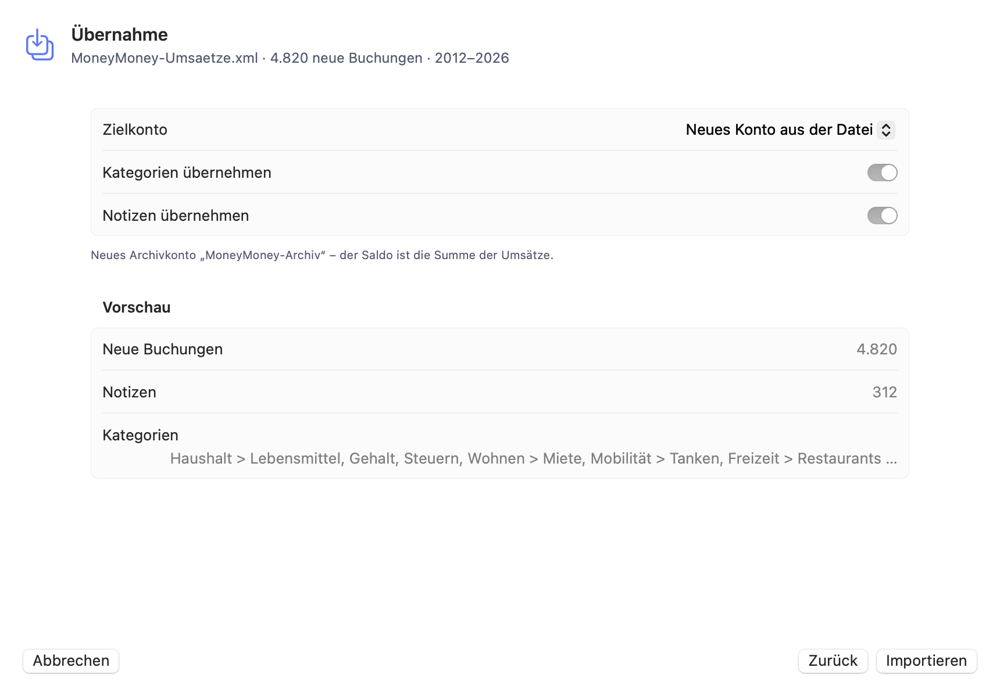
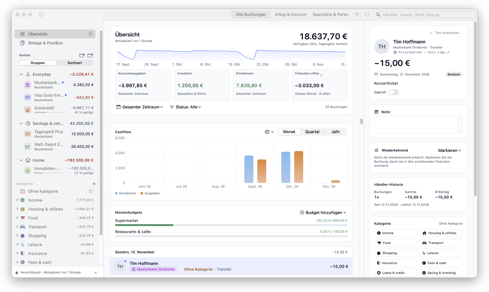
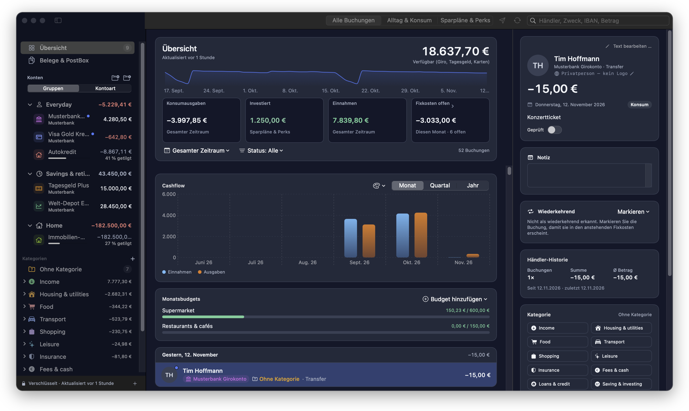

<p align="center">
  
</p>

<h1 align="center">GiroCrab</h1>

<p align="center">
  <a href="https://github.com/girocrab/girocrab/actions/workflows/ci.yml"></a>
  
  
  
  
  
</p>

<p align="center"><b>🇩🇪 <a href="#-deutsch">Deutsch</a> · 🇬🇧 <a href="#-english">English</a></b></p>

---

## 🇩🇪 Deutsch

**Open-Source-Banking für macOS 14+ (Apple Silicon) und iOS 17+ – lokal, verschlüsselt, ohne Cloud-Zwang.**
Native SwiftUI-App auf einem Rust-Kern: verschlüsselter Datentresor (XChaCha20-Poly1305 & Argon2id), Kategorienbaum,
Regeln, Händler-Erkennung, Sparplan-Ansicht, Darlehens-Tilgungsbalken und direkte Verbindungen
zu Ihren Banken – ohne Server, ohne Tracking.

### ✨ Neu in v0.5.1

- ✅ **Apple-notarisiert:** Der macOS-Download ist jetzt offiziell von Apple notarisiert – kein Gatekeeper-Umweg mehr nötig.
- 🔒 **Händler-Logos nur per Opt-in (#38):** Online-Logos sind standardmäßig **aus**; erst wenn Sie sie unter *Einstellungen → Händler-Logos* aktivieren, werden Logos geladen. Ohne Opt-in bleibt alles zu 100 % lokal.
- ✏️ **Notiz per Doppelklick oder Return bearbeiten (#41).**
- 🗄️ **MoneyMoney-Import** (Datenbank, CSV/XML) – siehe [Umzug von MoneyMoney](#-umzug-von-moneymoney-in-60-sekunden).

**Seit v0.4.0:**

- 🗄️ **Direkter MoneyMoney-Datenbank-Import:** die verschlüsselte `MoneyMoney.sqlite` wird **nur lesend** geöffnet – Konten, Kategorien samt Hierarchie und die komplette Buchungshistorie kommen in einem Schritt (zusätzlich zu CSV/XML).
- 📱 **iOS-App (iPhone & iPad)** neben der macOS-App.
- ☁️ **Optionale iCloud-Drive-Synchronisation** zwischen Macs und iOS-Geräten per verschlüsseltem Snapshot-Merge.
- 🏦 **bunq direkt** per persönlichem API-Schlüssel – neben FinTS 3.0/HBCI, PayPal und Trade Republic.
- 🧬 **Apple Silicon (`arm64`)** auf macOS 14+ sowie iOS 17+.

### 🚚 Umzug von MoneyMoney in 60 Sekunden

Mehrjährige Historien, Kategorien und Notizen lassen sich verlustfrei übernehmen – ohne Abo-Bindung.

**Variante A – direkt aus der MoneyMoney-Datenbank (empfohlen, macOS):**

1. In GiroCrab: *Von MoneyMoney wechseln* (Onboarding), *MoneyMoney-Import* (Seitenleiste) oder `⌘K` → „MoneyMoney Historie & Kategorien importieren“ → Tab **MoneyMoney-Datenbank**.
2. `MoneyMoney.sqlite` auswählen und das MoneyMoney-Passwort eingeben. Die Datei wird ausschließlich **lesend** geöffnet; MoneyMoney und die Originaldatei bleiben unverändert.
3. Vorschau prüfen (Konten, Kategorien, Buchungen, Notizen), Zielkonten zuordnen, **Importieren**.

<p align="center"></p>

**Variante B – Export-Datei (CSV / XML):**

1. In MoneyMoney das Konto wählen, **⌘A**, **Umsätze exportieren …** → **XML** oder **CSV**.
2. In GiroCrab denselben Import-Dialog öffnen, Tab **Export-Datei (CSV/XML)** wählen und die Datei hineinziehen.
3. Zielkonto wählen (oder neues Archivkonto anlegen), Vorschau prüfen, **Importieren**.

<p align="center"></p>

Kategorien (`Haushalt\Lebensmittel`) bleiben als Baum erhalten, Notizen stehen in der Buchungsdetail-Ansicht.
Jeder Umsatz erhält einen Fingerabdruck (Datum, Betrag, IBAN/Name, Verwendungszweck): Ein erneuter Import
oder später per FinTS abgerufene, überlappende Tage erzeugen **keine Duplikate** – vorhandene Buchungen werden
nur um Kategorie und Notiz ergänzt.
**Gewohnte Komfort-Funktionen für Umsteiger:**
* **📋 Sm@rtPaste (`⌘V` / `⇧⌘V`):** Rechnungstexte oder Bankverbindungen aus der Zwischenablage direkt ins Überweisungsfenster einfügen – Empfänger, prüfsummengültige IBAN, BIC, Betrag und Verwendungszweck werden automatisch erkannt.
* **📄 E-Rechnungen & PDF-Drop:** PDF-Rechnungen einfach auf das Überweisungsfenster ziehen (liest eingebettetes **ZUGFeRD / Factur-X XML**, **EPC-QR-Codes / GiroCode** oder den PDF-Text).
* **✅ Geprüft-Häkchen (`Space`):** Umsätze in der Liste direkt per Leertaste als „geprüft“ markieren.
* **🖱️ Rechtsklick-Workflows:** Mit einem Klick alle Buchungen desselben Empfängers filtern (*„Nach ‚…‘ suchen“*) oder eine *„Neue Überweisung aus Buchung …“* vorausfüllen lassen.

### Funktionen im Überblick

<p align="center"></p>

<p align="center"></p>

*Alle Screenshots zeigen ausschließlich erfundene Demo-Daten (`GIROCRAB_DEMO_SEED=1`).*

- 🔒 **Local-First:** Alle Bankdaten bleiben auf Ihrem Gerät – in einem verschlüsselten Tresor (XChaCha20-Poly1305), geschützt durch Schlüsselbund / Touch ID bzw. Face ID. Es gibt keinen Entwickler-Server.
- 📱 **macOS + iOS (iPhone / iPad):** eine SwiftUI-Codebasis auf dem gemeinsamen Rust-Kern. Voraussetzungen: **macOS 14+ (Apple Silicon, `arm64`)** bzw. **iOS 17+**. Die iOS-App wird derzeit direkt aus dem Quellcode mit Xcode gebaut und installiert (`GiroCrabApp/Xcode/GiroCrab.xcodeproj`, Signierung mit persönlicher Apple-ID) – siehe [Schnellstart](#schnellstart).
- ☁️ **Optionale iCloud-Drive-Synchronisation:** Wer möchte, gleicht Tresor-Daten zwischen Macs und iOS-Geräten über den eigenen iCloud-Drive-Ordner (`iCloud Drive/GiroCrab/`) ab. In die Cloud wandert der Tresor nur als **verschlüsselter SQLCipher-Snapshot** (`wal_checkpoint(TRUNCATE)`); der Abgleich erfolgt deterministisch per `ATTACH DATABASE`-Merge. Eine **laufende SQLite-Datenbank mit WAL-Dateien wird nie direkt im Cloud-Speicher geöffnet.** Die Synchronisation ist **standardmäßig ausgeschaltet** und wird erst in den Einstellungen aktiviert; danach läuft der Abgleich beim Entsperren des Tresors. Der Ordner `iCloud Drive/GiroCrab/` wird erst angelegt, wenn Sie die Synchronisation aktivieren. 🔑 **Schlüssel:** Der Tresor-Schlüssel liegt **nicht** im iCloud-Ordner (die frühere Datei `tresor.key` aus v0.4.0 wird beim nächsten Abgleich automatisch gelöscht). Stattdessen teilt GiroCrab ihn standardmäßig über den **iCloud-Schlüsselbund** (`kSecAttrSynchronizable`, abschaltbar in den Einstellungen). Alternativ kopieren Sie den Schlüssel auf dem ersten Gerät („Tresor-Schlüssel kopieren“, Zwischenablage wird nach 60 s geleert) und fügen ihn einmalig auf dem zweiten Gerät ein („Schlüssel einfügen …“). ⚠️ Wer bereits v0.4.0 mit aktivem Sync genutzt hat: Die alte `tresor.key` kann noch in iCloud-Versionen/Papierkorb liegen; eine Schlüsselrotation ist für ein späteres Update geplant.
- 🗄️ **MoneyMoney-Datenbank-Import:** lesender Import der verschlüsselten `.sqlite`-Datei inkl. Konten, Kategorien, Hierarchie und Buchungshistorie (siehe oben).
- 🏦 **Native deutsche Bank-Protokolle:** FinTS 3.0 / HBCI (CAMT.052 & MT940 mit intelligenter Latin-1/UTF-8-Erkennung), **bunq** (persönlicher API-Schlüssel), PayPal, Trade-Republic-WebSocket, comdirect-REST sowie eingebettete Web-Session-/CSV-Importe für Amex & Amazon Visa.
- 💸 **SEPA-Überweisungen via FinTS 3.0 / HKCCS** inkl. PushTAN, SecureGo plus & ChipTAN/photoTAN: IBAN-Prüfung (Mod-97), SEPA-konformer Zeichensatz, Empfängervorschläge aus bisherigen Buchungen und sofort vorgemerkte Buchung.
- 🏠 **Intelligente Darlehens-Verfolgung:** Tilgungsfortschritt in Prozent und automatische Verknüpfung der monatlichen „Zins & Tilgung“-Raten vom Girokonto.
- 🏷️ **Händler-Erkennung & Logos (Opt-in):** Händler und ETFs (REWE, EnBW, DB, iShares) werden lokal erkannt; Privatpersonen (z. B. „Max Mustermann“) erhalten bewusst nur neutrale Initialen. Händler-Logos werden **standardmäßig nicht** aus dem Netz geladen – das passiert erst nach Ihrer Zustimmung in den Einstellungen.
- ✏️ **Notizen schnell bearbeiten:** Doppelklick oder Return auf die Notiz in der Buchungsdetail-Ansicht.
- 🌙 **macOS Dark Mode:** folgt automatisch dem System-Erscheinungsbild (Hell/Dunkel).
- 🌐 **Lokalisierung DE/EN:** Die App ist auf Deutsch und Englisch verfügbar und folgt der Systemsprache.

| Darlehen mit Tilgungsbalken | Inspektor mit Händler-Logo |
|---|---|
|  |  |

| SEPA-Überweisung mit IBAN-Prüfung | MoneyMoney-Datenbank-Import |
|---|---|
|  |  |

| iOS – Übersicht | iOS – Buchungen |
|---|---|
|  |  |

### Architektur

```
┌──────────────────────────┐   UniFFI    ┌────────────────────────────────────┐
│ GiroCrabApp (SwiftUI)    │ ◄─────────► │ girocrab-core (Rust)               │
│ macOS 14+ (arm64) · iOS  │  Swift-API  │  vault.rs      XChaCha20-Tresor    │
│ 17+ · Face/Touch ID      │             │  rules.rs      Kategorien-Regeln   │
└──────────────────────────┘             │  merchants.rs  Händler-Erkennung   │
   ▲ optional: iCloud Drive              │  connectors/   FinTS · REST · PSD2 │
   │ (verschlüsselter Snapshot)          └──────────────┬─────────────────────┘
                                                        │ direkt, mit Ihren Zugangsdaten
                                                        ▼
                                                  Ihre Bank(en)
```

Kurz: `girocrab-core` (Rust, per UniFFI) enthält Tresor, Regeln, Händler-Erkennung und Bank-Konnektoren; `GiroCrabApp` (SwiftUI) ist die native Oberfläche für macOS und iOS. **Mitwirken:** siehe [CONTRIBUTING.md](CONTRIBUTING.md) – bitte lassen Sie sich ein Issue **vor Arbeitsbeginn zuweisen** (Ausnahme: Kleinstkorrekturen).

### Bank-Unterstützung

| Institut | Verfahren | Status |
|---|---|---|
| Volksbanken & Sparda-Banken (Atruvia) / Postbank / DKB / 1822direkt – oder jede FinTS-3.0-Bank per BLZ + URL | FinTS 3.0 PIN/TAN (HKCAZ/camt, HKKAZ/MT940, Darlehen) | ✅ Unterstützt |
| comdirect | Offizielle REST-API | ✅ Unterstützt |
| bunq | Offizielle API, persönlicher API-Schlüssel | ✅ Unterstützt |
| PayPal | Transaction-Search-API | ✅ Unterstützt |
| Trade Republic | WebSocket (inoffiziell) | ⚠️ Unterstützt, kann brechen |
| American Express / Amazon Visa | PSD2 via Enable Banking | ✅ Unterstützt |
| ING, N26, Scalable Capital, Consorsbank, Santander | – | 🙋 **Help Wanted** |

Eine neue Bank anzubinden dauert meist unter 100 Zeilen: siehe
[`connectors/template.rs`](girocrab-core/src/connectors/template.rs) und [CONTRIBUTING.md](CONTRIBUTING.md).

### Schnellstart

Voraussetzungen: **macOS 14+ auf Apple Silicon (`arm64`)**, Xcode 15+, [rustup](https://rustup.rs). iOS-Geräte benötigen **iOS 17+**.

```bash
./build-xcframework.sh          # Rust-Kern + Swift-Bindings (macOS / XCFramework)
cargo run -- --demo-seed        # App mit erfundenen Demo-Daten starten
# oder: GIROCRAB_DEMO_SEED=1 cargo run
cargo test -p girocrab-core     # Tests
```

Die Demo enthält fiktive Konten und erfundene Buchungen – keine echten Daten.

*Intel-Mac?* Der Quellcode-Build funktioniert auch dort mit Swift/Xcode; nur die fertigen Release-Binaries gibt es ausschließlich für Apple Silicon.

**iOS (iPhone / iPad):** Die App wird derzeit nicht über den App Store verteilt, sondern direkt aus dem Quellcode gebaut:
`GiroCrabApp/Xcode/GiroCrab.xcodeproj` in Xcode öffnen, Team (persönliche Apple-ID) unter *Signing & Capabilities* wählen und auf das Gerät installieren. Mit einer persönlichen Apple-ID signierte Apps laufen nur eine begrenzte Zeit und müssen danach neu installiert werden.

### 📦 Download (macOS)

Fertige `GiroCrab-macOS-arm64.zip`-Builds (Apple Silicon, macOS 14+) gibt es unter [GitHub Releases](../../releases) – ohne Rust oder Xcode.
Aktuelle Version: **v0.5.1**. Entpacken und `GiroCrab.app` nach `/Programme` verschieben – die App ist **von Apple notarisiert** und lässt sich ohne Zusatzschritte öffnen.

**Intel-Macs:** Die offiziellen Binaries sind nur für Apple Silicon (`arm64`). Auf Intel-Macs lässt sich GiroCrab mit Swift/Xcode selbst aus dem Quellcode bauen (siehe [Schnellstart](#schnellstart)).

### ⚖️ Rechtlicher Hinweis / Haftungsausschluss (ZAG / PSD2)

GiroCrab ist ein **kostenloses, nicht-kommerzielles Open-Source-Werkzeug zur ausschließlich eigenen Nutzung** (selbst gehostete Software).
Es ist **kein Zahlungsauslösedienst und kein Kontoinformationsdienst im Sinne des ZAG bzw. der Richtlinie (EU) 2015/2366 (PSD2)**
und wird auch nicht als solcher angeboten.

- **Rein lokal:** Alle Verbindungen laufen ausschließlich direkt zwischen **Ihrem Gerät** und **Ihrer Bank** – mit **Ihren** Zugangsdaten,
  **Ihrer** FinTS-Produktregistrierung und **Ihren** API-Schlüsseln. Die Entwickler betreiben **keinen** Server; Konto-, Buchungs- oder
  Zugangsdaten gelangen **zu keinem Zeitpunkt** an die Entwickler. Die optionale iCloud-Synchronisation nutzt ausschließlich Ihren
  eigenen iCloud-Drive-Speicher (verschlüsselter Snapshot; der Schlüssel läuft über den iCloud-Schlüsselbund, siehe oben).
- **Nutzung auf eigenes Risiko, ohne Gewährleistung** (siehe GPLv3). Das gilt insbesondere für **SEPA-Überweisungen** – prüfen Sie
  Empfänger, IBAN und Betrag vor jeder Freigabe selbst – sowie für **inoffizielle Schnittstellen** (z. B. Trade Republic), die
  jederzeit ausfallen können und gegen Nutzungsbedingungen des Anbieters verstoßen können.
- Wer GiroCrab **für Dritte** betreibt, braucht ggf. eine BaFin-Erlaubnis – das ist nicht der vorgesehene Einsatzzweck.
- Keine Anlageberatung; ISIN/WKN-Angaben sind Referenzdaten ohne Gewähr. Marken gehören ihren Inhabern und dienen nur der Wiedererkennung.

---

## 🇬🇧 English

**Open-source banking for macOS 14+ (Apple Silicon) and iOS 17+ – local-first, encrypted, no cloud required.**
A native SwiftUI app on a Rust core: encrypted vault (XChaCha20-Poly1305 & Argon2id), category tree, rules, merchant
recognition, savings-plan view, loan repayment progress and direct connections to your banks –
no server, no tracking. Money is always `i64` cents, never floats.

### ✨ What's new in v0.5.1

- ✅ **Apple-notarized:** the macOS download is now officially notarized by Apple – no Gatekeeper workarounds needed.
- 🔒 **Merchant logos are opt-in (#38):** online logos are **off** by default; nothing is fetched until you enable them under *Settings → Merchant logos*. Without the opt-in everything stays 100 % local.
- ✏️ **Edit a note by double-click or Return (#41).**
- 🗄️ **MoneyMoney import** (database, CSV/XML) – see [Migrating from MoneyMoney](#-migrating-from-moneymoney).

**Since v0.4.0:**

- 🗄️ **Direct MoneyMoney database import:** the encrypted `MoneyMoney.sqlite` is opened **read-only** – accounts, categories incl. hierarchy and the full booking history come over in one step (in addition to CSV/XML).
- 📱 **iOS app (iPhone & iPad)** alongside the macOS app.
- ☁️ **Optional iCloud Drive sync** between Macs and iOS devices via an encrypted snapshot merge.
- 🏦 **bunq direct integration** via personal API key – alongside FinTS 3.0/HBCI, PayPal and Trade Republic.
- 🧬 **Apple Silicon (`arm64`)** on macOS 14+ and iOS 17+.

### 🚚 Migrating from MoneyMoney

Full multi-year histories, categories and notes import seamlessly – no subscription lock-in.

**Option A – straight from the MoneyMoney database (recommended, macOS):**

1. In GiroCrab: *Switch from MoneyMoney* (onboarding), *MoneyMoney-Import* (sidebar) or `⌘K` → "MoneyMoney Historie & Kategorien importieren" → tab **MoneyMoney database**.
2. Choose `MoneyMoney.sqlite` and enter your MoneyMoney password. The file is opened strictly **read-only**; MoneyMoney and the original file stay untouched.
3. Check the preview (accounts, categories, bookings, notes), map the target accounts, hit **Import**.

<p align="center"></p>

**Option B – export file (CSV / XML):**

1. In MoneyMoney select the account, press **⌘A**, then **Export Transactions …** → **XML** or **CSV**.
2. In GiroCrab open the same import dialog, pick the **Export file (CSV/XML)** tab and drop the file in.
3. Pick the target account (or create an archive account), check the preview, hit **Import**.

Hierarchical categories (`Household\Groceries`) are kept as a tree, notes show in the booking detail view.
Every booking gets a fingerprint (date, amount, IBAN/name, purpose), so re-importing the file or overlapping days
fetched later via FinTS **never create duplicates** – existing bookings are only enriched with category and note.
**Familiar everyday workflows:**
* **📋 Sm@rtPaste (`⌘V` / `⇧⌘V`):** Paste invoice text or bank details from the clipboard straight into the transfer sheet — recipient, checksum-verified IBAN, BIC, amount and purpose are filled in automatically.
* **📄 E-Invoice & PDF Drop:** Drag & drop a PDF invoice onto the transfer sheet (parses embedded **ZUGFeRD / Factur-X XML**, **EPC QR / GiroCode**, or PDF/OCR text).
* **✅ Checked toggle (`Space`):** Mark bookings as checked directly via the Spacebar.
* **🖱️ Context menu actions:** Right-click any booking to filter all transactions by that counterparty or pre-fill a new transfer from the booking.
### Features & Screenshots

<p align="center"></p>

<p align="center"></p>

*All screenshots show purely fictional demo data (`GIROCRAB_DEMO_SEED=1`).*

- 🔒 **Local-first:** all banking data lives on your device in an encrypted vault (XChaCha20-Poly1305) protected by the Keychain / Touch ID or Face ID. There is no developer server.
- 📱 **macOS + iOS (iPhone / iPad):** one SwiftUI codebase on the shared Rust core. Requires **macOS 14+ (Apple Silicon, `arm64`)** or **iOS 17+**. The iOS app is currently built and installed straight from source with Xcode (`GiroCrabApp/Xcode/GiroCrab.xcodeproj`, personal Apple ID signing) – see [Quickstart](#quickstart).
- ☁️ **Optional iCloud Drive sync:** if you want, sync vault data between Macs and iOS devices through your own iCloud Drive folder (`iCloud Drive/GiroCrab/`). The vault goes to the cloud only as an **encrypted SQLCipher snapshot** (`wal_checkpoint(TRUNCATE)`), and devices are reconciled with a deterministic `ATTACH DATABASE` merge. **A live SQLite database with WAL files is never opened directly in cloud storage.** Sync is **off by default** and has to be enabled in Settings; once on, it runs when the vault is unlocked. The folder `iCloud Drive/GiroCrab/` is only created once you enable sync. 🔑 **Key handling:** the vault key is **not** stored in the iCloud folder (the `tresor.key` file from v0.4.0 is deleted automatically on the next sync). By default GiroCrab shares it through **iCloud Keychain** (`kSecAttrSynchronizable`, can be turned off in Settings). Alternatively, copy the key on the first device (“Copy vault key”, clipboard is cleared after 60 s) and paste it once on the second device (“Paste key …”). ⚠️ If you used v0.4.0 with sync enabled, the old `tresor.key` may still exist in iCloud versions/trash; key rotation is planned for a later release.
- 🗄️ **MoneyMoney database import:** read-only import of the encrypted `.sqlite` file incl. accounts, categories, hierarchy and booking history (see above).
- 🏦 **Native German banking protocols:** FinTS 3.0 / HBCI (CAMT.052 & MT940 with smart Latin-1/UTF-8 decoding), **bunq** (personal API key), PayPal, Trade Republic WebSocket, comdirect REST, and embedded web-session/CSV import for Amex & Amazon Visa.
- 💸 **Native SEPA credit transfers via FinTS 3.0 / HKCCS** incl. PushTAN, SecureGo plus & ChipTAN/photoTAN: IBAN checksum validation (Mod-97), SEPA-compliant character set, recipient suggestions from past bookings and an instant pending booking.
- 🏠 **Smart loan tracking:** automatic repayment progress (%) and cross-account linking of the monthly "Zins & Tilgung" instalments from your checking account.
- 🏷️ **Merchant recognition & logos (opt-in):** German merchants & ETFs (REWE, EnBW, DB, iShares) are recognized locally, while private individuals (e.g. "Max Mustermann") get plain monogram initials by design. Merchant logos are **not** fetched online by default – only after you opt in under Settings.
- ✏️ **Quick note editing:** double-click or press Return on the note in the booking detail view.
- 🌙 **macOS Dark Mode:** automatically follows the system appearance (light/dark).
- 🌐 **German & English localization:** the app ships in German and English and follows the system language.

| Loan with repayment bar | Inspector with merchant logo |
|---|---|
|  |  |

| SEPA transfer with IBAN check | MoneyMoney database import |
|---|---|
|  |  |

| iOS – Overview | iOS – Transactions |
|---|---|
|  |  |

### Architecture

See the diagram above: the SwiftUI app (`GiroCrabApp`, macOS and iOS) talks to `girocrab-core` (Rust) through UniFFI; the core owns the
encrypted vault, categorisation rules, merchant resolver and the bank connectors, and talks to
your bank directly. Optional iCloud sync exchanges an encrypted snapshot via your own iCloud Drive.

**Contributing:** see [CONTRIBUTING.md](CONTRIBUTING.md) – please ask to be **assigned to an issue before you start** (tiny fixes excepted).

### Bank support matrix

| Bank | Protocol | Status |
|---|---|---|
| Volksbanken & Sparda-Banken (Atruvia) / Postbank / DKB / 1822direkt – or any FinTS 3.0 bank via bank code + URL | FinTS 3.0 PIN/TAN (camt, MT940, loans) | ✅ Supported |
| comdirect | Official REST API | ✅ Supported |
| bunq | Official API, personal API key | ✅ Supported |
| PayPal | Transaction Search API | ✅ Supported |
| Trade Republic | WebSocket (unofficial) | ⚠️ Supported, may break |
| American Express / Amazon Visa | PSD2 via Enable Banking | ✅ Supported |
| ING, N26, Scalable Capital, Consorsbank, Santander | – | 🙋 **Help wanted** |

Adding a bank usually takes under 100 lines – start from
[`connectors/template.rs`](girocrab-core/src/connectors/template.rs) and read [CONTRIBUTING.md](CONTRIBUTING.md).

### Download (macOS)

Pre-built `GiroCrab-macOS-arm64.zip` binaries (Apple Silicon, macOS 14+) are available under
[GitHub Releases](../../releases) – no Rust or Xcode required. Current version: **v0.5.1**. Unzip and move `GiroCrab.app` to `/Applications` – the app is **notarized by Apple** and opens without any extra steps.

**Intel Macs:** the official binaries are Apple Silicon (`arm64`) only. On Intel Macs you can build GiroCrab yourself from source with Swift/Xcode (see [Quickstart](#quickstart)).

### Quickstart

Requirements: **macOS 14+ on Apple Silicon (`arm64`)**, Xcode 15+, [rustup](https://rustup.rs). iOS devices need **iOS 17+**.

```bash
./build-xcframework.sh          # Rust core + Swift bindings (macOS / XCFramework)
cargo run -- --demo-seed        # launch the app with fictional demo data
# or: GIROCRAB_DEMO_SEED=1 cargo run
cargo test -p girocrab-core     # run the tests
```

The demo ships fictional accounts and invented bookings – no real data.

*Intel Mac?* Building from source with Swift/Xcode works there too; only the pre-built release binaries are Apple Silicon-only.

**iOS (iPhone / iPad):** the app is currently not distributed via the App Store but built from source:
open `GiroCrabApp/Xcode/GiroCrab.xcodeproj` in Xcode, choose your team (personal Apple ID) under *Signing & Capabilities* and install on your device. Apps signed with a personal Apple ID expire after a limited time and have to be reinstalled.

### ⚖️ Legal notice / Disclaimer (PSD2 / ZAG)

GiroCrab is a **free, non-commercial open-source tool for your own personal use only** (self-hosted software).
It is **not a payment initiation service and not an account information service within the meaning of the German ZAG / PSD2
(Directive (EU) 2015/2366)** and is not offered as one.

- **Strictly local:** all connections run directly between **your device** and **your bank**, using **your** credentials,
  **your** FinTS product registration and **your** API keys. The authors operate **no** server, and no account, booking or
  credential data **ever** reaches the authors. Optional iCloud sync uses only your own iCloud Drive storage (encrypted snapshot; the key goes through iCloud Keychain, see above).
- **Use at your own risk, without warranty** (see GPLv3). This applies in particular to **SEPA transfers** – always verify
  recipient, IBAN and amount yourself before authorising – and to **unofficial interfaces** (e.g. Trade Republic), which can
  break at any time and may violate the provider's terms of service.
- Operating GiroCrab **for third parties** may require BaFin authorisation and is not the intended use.
- Not investment advice; ISIN/WKN data is reference information without guarantee. Trademarks belong to their owners and are used for identification only.

---

## Security / Sicherheit

XChaCha20-Poly1305 + Argon2id encrypted vault, key in the Keychain (`ThisDeviceOnly`), PINs/TANs only in memory
(`zeroize`), no telemetry. Merchant logos are **opt-in** (off by default, Settings → Merchant logos); without it, no network
request is made for logos and everything stays 100 % local. **Never attach real bank data or credentials to issues.**

DE: Händler-Logos sind **standardmäßig deaktiviert** (Opt-in in den Einstellungen) – ohne Zustimmung werden keine Logos aus dem Netz geladen, alles bleibt zu 100 % lokal.

---

## 🏦 Wie funktioniert der Bankabgleich? (FAQ & Technik)

### 1. Wie richte ich den Abgleich mit meinen Banken ein?
1. **Bankverbindung hinterlegen:** Klicke unten in der linken Seitenleiste (oder über die Befehlspalette `⌘K`) auf **„Bankverbindungen“** (*Connections*) → **„Bankverbindung hinzufügen“**.
   - **Klassische Banken (Sparkassen, Volksbanken, DKB, ING, Comdirect, Deutsche Bank etc.):** Wähle **FinTS / HBCI** und melde dich mit deiner BLZ/BIC sowie deiner Online-Banking-Kennung und PIN an.
   - **Neobroker & Direktbanken (Trade Republic, Scalable Capital, N26, Revolut etc.):** Wähle den jeweiligen Direkt-Konnektor aus und melde dich mit deinen regulären Zugangsdaten an.
2. **2FA bestätigen:** Bestätige die Freigabe (Push-TAN / App-Freigabe / PhotoTAN) einmalig auf deinem Smartphone. GiroCrab legt alle gefundenen Konten automatisch an.
3. **Umsätze abrufen (Rundruf):** Klicke oben in der Symbolleiste auf **Synchronisieren (`↻`)** oder drücke **`⌘R`**. GiroCrab ruft neue Umsätze und Salden ab, wendet deine Kategorien-Regeln an und verhindert über deterministische Buchungs-Fingerprints zuverlässig Duplikate (auch nach einem vorherigen CSV-/CAMT-Import aus MoneyMoney).

### 2. Läuft der Abgleich technisch über einen Drittanbieter-Service oder über Webscraping?
**Weder noch!** GiroCrab arbeitet zu **100 % direkt (Point-to-Point)** zwischen deinem Gerät und der Bank – ohne Cloud-Backend, ohne PSD2-Kontoinformationsdienst (wie FinAPI, Tink oder GoCardless) dazwischen und ohne Headless-Browser/HTML-Scraping:

* **Natives FinTS 3.0 / HBCI:** Klassische Banken werden direkt aus dem Rust-Kern (`girocrab-core`) über die offiziellen FinTS-3.0-HTTPS-Endpunkte angesprochen (inkl. starker Kundenauthentifizierung nach TAN-Prozess 996/997, Decoupled-TAN, PushTAN & PhotoTAN sowie Abruf von MT940 / CAMT.052 / CAMT.053 und SEPA-Überweisungen via HKCCS).
* **Direkte Mobile-/Web-API-Clients in Rust:** Für Banken und Broker ohne FinTS-Schnittstelle (wie Trade Republic oder Scalable Capital) nutzt GiroCrab keine fragilen Browser-Scraper, sondern spricht über `reqwest` + `rustls` direkt die nativen JSON-, GraphQL- und WebSocket-Endpunkte der Banken an (z. B. lokales ECDSA-P256-Device-Pairing und signierte Requests bei Trade Republic).
* **Zero-Knowledge Datenhaltung & iCloud-Sync (macOS & iOS):** Alle Zugangsdaten, Session-Tokens und Umsätze liegen ausschließlich lokal in deinem mit **XChaCha20-Poly1305 & Argon2id** verschlüsselten SQLCipher-Tresor (geschützt durch Touch ID / Face ID). Über den optionalen **Zero-Knowledge iCloud-Sync** lassen sich Tresore zwischen Mac und iPhone/iPad konfliktfrei auf Buchungs-Fingerprint-Ebene zusammenführen, ohne dass Klartextdaten jemals dein Gerät verlassen.


## License / Lizenz

GPL-3.0-or-later – see [LICENSE](LICENSE).

---

## ☕ Projekt unterstützen (Freiwillige Zuwendung)

**GiroCrab** ist ein freies Open-Source-Projekt. Wenn dir die App im Alltag hilft und du die Weiterentwicklung mit einer kleinen **freiwilligen Zuwendung** (ohne Gegenleistung) für die Kaffeekasse unterstützen möchtest:

[](https://paypal.me/aprinz)

*English:* If you enjoy using GiroCrab and would like to support its development with a **voluntary contribution / tip** (no consideration expected): **[paypal.me/aprinz](https://paypal.me/aprinz)**

---

📄 **Open-Source-Lizenzen / Third-Party Notices:** Eine Übersicht aller im Rust-Kern verwendeten Open-Source-Bibliotheken und ihrer Lizenzen befindet sich in [THIRD_PARTY_NOTICES.md](THIRD_PARTY_NOTICES.md).
